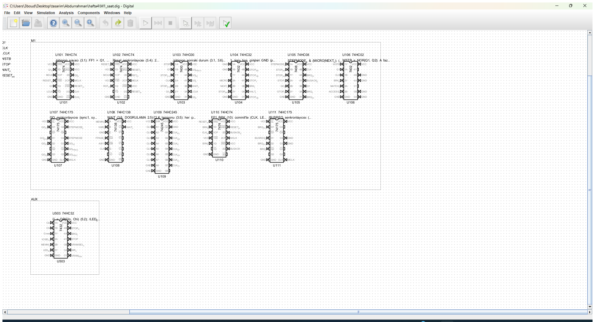
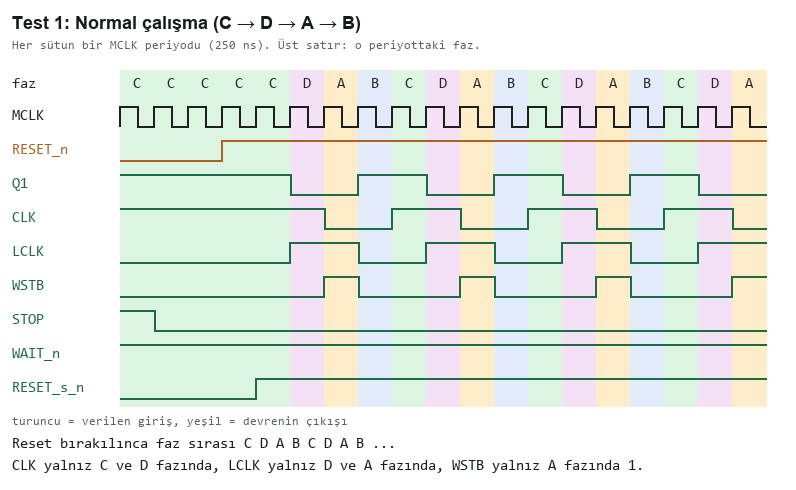
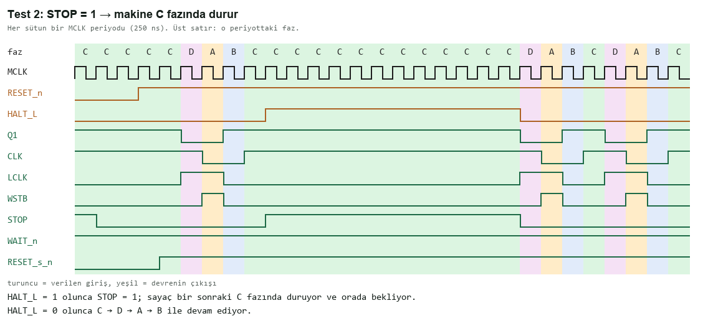
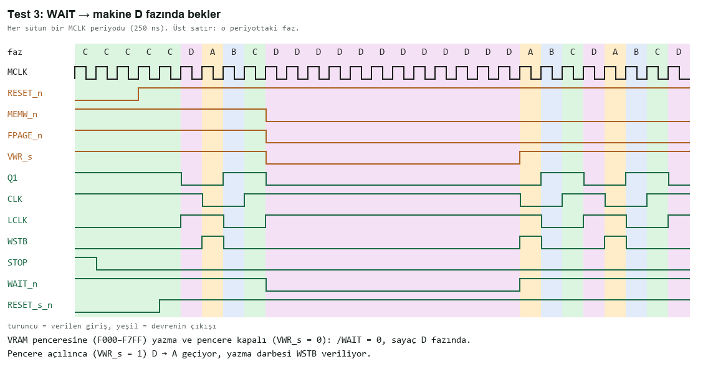
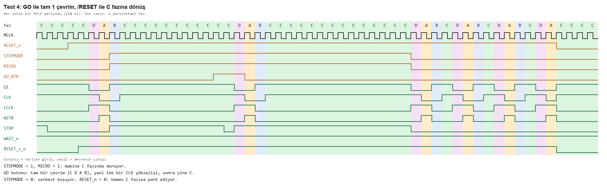

# Hafta 1 (27 Ekim – 2 Kasım 2026): M1 saat modülü, Digital'de

Hazırlayan: Abdurrahman

## Özet

- 1. haftanın işi (M1 saat modülü) ve 2. haftaya kalan testleri (kilometre taşı K1). İlk Proteus dosyası silindiği için Digital'de yeniden kuruldu (18 Kasım).
- Devre, planın M1 modülünün 11 entegresi ve STOP denkleminin son OR kapısını içeren U503: **12 entegre**.
- Planın istediği **4 testin dördü de Digital'de geçti** (Digital'in kendi test aracıyla, komut satırından).
- İlk kilometre taşı **K1 (M1 testleri geçiyor)** tamamlandı.

## Dosyalar

| Dosya | İçerik |
|---|---|
| `M1_saat.dig` | Devre + 4 test (Digital'in Test case bileşeni) |
| `images/m1_digital_ekran.png` | Devrenin Digital'deki ekran görüntüsü |
| `images/m1_devre.svg` | Devrenin tamamı, Digital'den SVG olarak (yakınlaştırılabilir) |
| `images/m1_1_normal.png` … `m1_4_go_reset.png` | 4 testin dalga şekilleri |
| `images/digital_test_ciktisi.txt` | Digital komut satırı test çıktısı |

## Devre



| Entegre | Görev | Plan |
|---|---|---|
| U101 74HC74 | Johnson sayacı: Q1, Q2 → 4 faz (C, D, A, B). CLK = Q2, LCLK = /Q1 | 3.1 |
| U102 74HC74 | Reset senkronlayıcısı: basınca hemen, bırakınca 2 MCLK sonra | 3.4 |
| U103 74HC00 | Sonraki durum: Q1' = NAND(Q2, NAND(STOP, Q1)), Q2' = NAND(/Q1, /WAIT); /GO | 3.1, 3.6 |
| U104 74HC32, U105 74HC08, U503 74HC32 | STOP denklemi (HALT, BRK, adımlama, GO, BUSREQ) | 3.3 |
| U106 74HC02 | WSTB = NOR(Q1, Q2): yalnız A fazında 1 | 3.1 |
| U107 74HC175 | GO butonu senkronlayıcısı (tam 1 MCLK darbe) ve STEPMODE senkronlayıcısı | 3.3 |
| U108 74HC138 | WAIT: G1 = CLK (12 Kasım düzeltmesi), Y0 = /WAIT | 3.6 |
| U109 74HC245 | CLK tamponu, 7 dal | 3.5 |
| U110 74HC74 | BRK ve BUSACK flip-flop'ları | 3.3 |
| U111 74HC175 | /BUSREQ senkronlayıcısı | 3.3 |

Bacak bağlantıları ve sinyal adları [TD8-baglanti-tablosu.md](../../Tahadan-Abdurrahmana/TD8-baglanti-tablosu.md) bölüm M1 ile birebir aynı (kaynak: projenin bağlantı listesi `sim/td8/hw/cpu.py`). Böylece modüller birleştirilirken ad uyuşmazlığı olmuyor.

Fazlar (Q1 Q2): **A = 00, B = 10, C = 11, D = 01**. MCLK 4 MHz, her faz 250 ns, CPU çevrimi 1 µs.

## Testler

Her test Digital'de `M1_saat.dig` içindeki Test case ile çalıştırıldı; her satır bir MCLK periyodu. Dalga şekillerinde turuncu sinyaller verilen girişler, yeşiller devrenin çıkışları.

### Test 1: Normal çalışma

| Ne verildi | Ne bekleniyordu | Ne görüldü |
|---|---|---|
| RESET_n = 0 (3 periyot), sonra 1; diğer girişler pasif | Reset'te C fazı; sonra C → D → A → B sırası. CLK yalnız C ve D'de, LCLK yalnız D ve A'da, WSTB yalnız A'da 1 | Faz dizisi `CCCCC DABC DABC DABC DA`. CLK, LCLK ve WSTB tabloyla aynı. **Geçti** |



### Test 2: STOP = 1 → C fazında durma

| Ne verildi | Ne bekleniyordu | Ne görüldü |
|---|---|---|
| Çalışırken HALT_L = 1 (12 periyot), sonra 0 | STOP = 1; sayaç C fazında durur (`Q1' = !Q2 \| STOP & Q1`). HALT_L = 0 olunca devam | `…DAB CCCCCCCCCCCCC DABCDABC`: C'de durdu, bırakınca devam etti. **Geçti** |



### Test 3: WAIT → D fazında bekleme

| Ne verildi | Ne bekleniyordu | Ne görüldü |
|---|---|---|
| VRAM penceresine yazma: /MEMW = 0, /FPAGE = 0, AB11 = 0; pencere kapalı (VWR_s = 0). 12 periyot sonra VWR_s = 1 | /WAIT = 0 (yalnız Q2 = 1 iken); sayaç D fazında bekler. Pencere açılınca D → A ve WSTB | `…DABC DDDDDDDDDDDD ABCDABCD`: D'de bekledi, pencere açılınca A'ya geçti. **Geçti** |



### Test 4: GO ile tam 1 çevrim ve /RESET ile C'ye dönüş

| Ne verildi | Ne bekleniyordu | Ne görüldü |
|---|---|---|
| STEPMODE = 1, MICRO = 1; sonra GO_BTN = 1 (3 periyot); sonra STEPMODE = 0; en sonda RESET_n = 0 | Adımlamada C'de durur. GO: tam bir çevrim (tek CLK yükselişi), sonra yine C. STEPMODE = 0: serbest koşu. Reset: hemen C | C'de durdu; GO ile tek `DAB`, sonra C; serbest koşu `DABCDABC…`; reset ile `CCCC`. **Geçti** |



### Digital test çıktısı

```
> java -cp Digital.jar CLI test -circ M1_saat.dig
1_normal: passed
2_stop: passed
3_wait: passed
4_go_reset: passed
```

Digital'in arayüzünde de araç çubuğundaki test düğmesiyle (✓) aynı 4 test çalıştırılabilir.

## Sınırlar ve sonraki adımlar

- **Digital gecikmeleri modellemez:** burada yalnız işlev (mantık) doğrulandı. WAIT kararının 250 ns'ye yetişmesi (en kötü 247 ns, pay ~3 ns, SISTEM-PLANI 3.6) Digital'de görülemez; prototip a'da osiloskopla ölçülecek.
- Saat kaynağı seçici (74HC153), NE555 ve 74HC14 (RC reset, buton debounce) bu dosyada yok, planda da simülasyon kapsamı dışında. Girişler (RESET_n, GO_BTN) temiz sinyal olarak veriliyor.
- Sıradaki: **M4** (A, IR, F registerları ve ALU flash'ları), sonra **M3** (PC, AR, X, SP).
