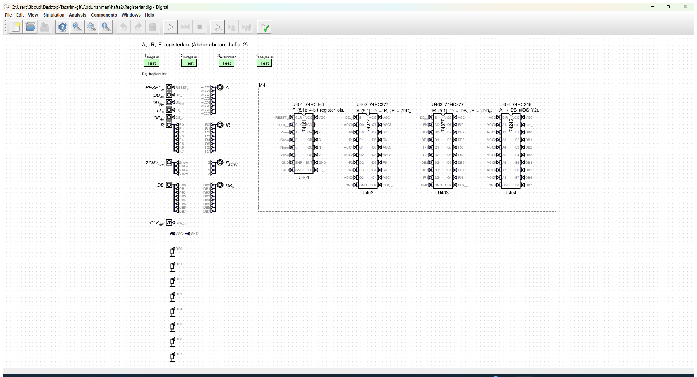
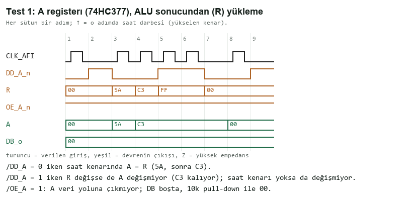
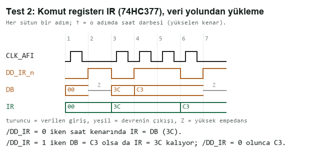
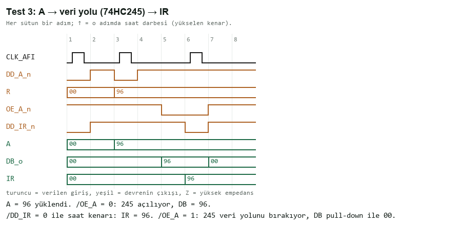
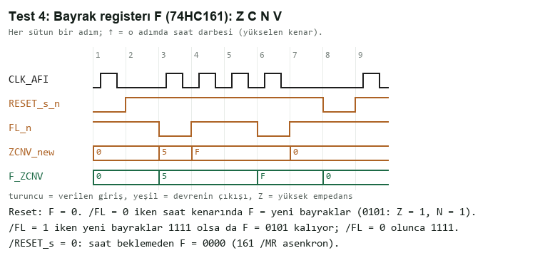

# Hafta 2 (3–9 Kasım 2026): A, IR ve F registerları, Digital'de

Hazırlayan: Abdurrahman

## Özet

- İlk sürümdeki A, B ve IR şemaları SAP-1 yapısındaydı (74LS173, B registerı). TD-8 planına göre ([SISTEM-PLANI 5.1](../../SISTEM-PLANI.md)) **Digital'de yeniden kuruldu** (18 Kasım):
  - **B registerı yok:** ALU'nun sağ girişi doğrudan veri yolu (DB).
  - **A:** 74HC377, girişi ALU sonucu (R), veri yolundan değil.
  - **IR:** 74HC377, girişi DB; veri yoluna geri çıkmaz, 8 bitin hepsi mikrokod ROM'larına gider.
  - **F (bayraklar Z, C, N, V):** 74HC161, 4-bit yüklemeli register olarak.
- Devre: **4 entegre** (U401–U404). Planın istediği **4 testin dördü de Digital'de geçti**.

## Dosyalar

| Dosya | İçerik |
|---|---|
| `Registerlar.dig` | Devre + 4 test (Digital'in Test case bileşeni) |
| `images/registerlar_digital_ekran.png` | Devrenin Digital'deki ekran görüntüsü |
| `images/registerlar_devre.svg` | Devrenin tamamı, Digital'den SVG |
| `images/reg_1_A_register.png` … `reg_4_F_bayraklar.png` | 4 testin dalga şekilleri |
| `images/digital_test_ciktisi.txt` | Digital komut satırı test çıktısı |

## Devre



| Entegre | Görev | Bağlantı |
|---|---|---|
| U401 74HC161 | **F** registerı: Z, C, N, V | D0–D3 = Znew, Cnew, Nnew, Vnew (ALU'dan); /PE = /FL; CEP = CET = 0 (sayma kapalı); /MR = /RESET_s; Q0–Q3 → Z C N V (uROM A12–A15, ALU) |
| U402 74HC377 | **A** registerı | D = R0–R7 (ALU sonucu); /E = /DD_A; Q = ACC0–ACC7 (ALU sol girişi + U404) |
| U403 74HC377 | **IR** komut registerı | D = DB0–DB7; /E = /DD_IR; Q = IR0–IR7 (uROM A4–A11) |
| U404 74HC245 | A → veri yolu tamponu | A = ACC0–ACC7, B = DB0–DB7, DIR = VCC; /OE = /OE_A |

Üç register da **CLK_AFI** ile saatlenir: M1'deki CLK tamponunun (U109) A + F + IR dalı. A ve F aynı dalda olmalı (SISTEM-PLANI 3.5: A → ALU → F döngüsünün tutma payı ~8 ns).

Bacak bağlantıları ve sinyal adları [TD8-baglanti-tablosu.md](../../Tahadan-Abdurrahmana/TD8-baglanti-tablosu.md) bölüm M4 (U401–U404) ile birebir aynı (kaynak: projenin bağlantı listesi `sim/td8/hw/cpu.py`).

Veri yolunda 8× 10k pull-down var: hiçbir çip sürmediğinde DB = 00.

## Testler

Her test önce başlangıç adımıyla başlar: A ve IR'nin reset'i yok (açılışta belirsiz), bu yüzden ilk saat kenarında ikisine 00 yüklenir ve F reset'lenir. Dalga şekillerinde turuncu sinyaller verilen girişler, yeşiller devrenin çıkışları.

### Test 1: A registerı

| Ne verildi | Ne bekleniyordu | Ne görüldü |
|---|---|---|
| /DD_A = 0, R = 5A, saat; R = C3, saat | A = 5A, sonra A = C3 | A = 5A, C3 |
| /DD_A = 1, R = FF, 2 saat kenarı | A değişmez | A = C3, C3 |
| /DD_A = 0, R = 00, saat kenarı **yok** | A değişmez (yalnız kenarda yükler) | A = C3 |
| saat kenarı | A = 00 | A = 00. Bütün test boyunca /OE_A = 1, DB = 00 (sürülmüyor). **Geçti** |



### Test 2: IR registerı

| Ne verildi | Ne bekleniyordu | Ne görüldü |
|---|---|---|
| /DD_IR = 0, DB = 3C, saat | IR = 3C | IR = 3C |
| /DD_IR = 1, DB = C3, 2 saat kenarı | IR değişmez | IR = 3C, 3C |
| /DD_IR = 0, saat | IR = C3 | IR = C3. **Geçti** |



### Test 3: A → veri yolu → IR

| Ne verildi | Ne bekleniyordu | Ne görüldü |
|---|---|---|
| A'ya 96 yüklendi; /OE_A = 1 | DB'yi kimse sürmüyor: 00 | DB = 00 |
| /OE_A = 0 | 245 açılır: DB = A = 96 | DB = 96 |
| /DD_IR = 0, saat | IR = DB = 96 | IR = 96 |
| /OE_A = 1 | 245 veri yolunu bırakır: DB = 00 | DB = 00, IR = 96 kalıyor. **Geçti** |



### Test 4: F bayrak registerı

Bayrak değerleri (Z C N V) sırasıyla yazıldı; şekilde ZCNV_new / F_ZCNV hex olarak Z = bit 0, C = bit 1, N = bit 2, V = bit 3 (5 = Z ve N, F = dördü).

| Ne verildi | Ne bekleniyordu | Ne görüldü |
|---|---|---|
| Başlangıçta /RESET_s = 0 | F = 0000 | Z C N V = 0 0 0 0 |
| /FL = 0, yeni bayraklar Z = 1, C = 0, N = 1, V = 0, saat | F yüklenir | Z C N V = 1 0 1 0 |
| /FL = 1, yeni bayraklar 1 1 1 1, 2 saat kenarı | F değişmez | 1 0 1 0 |
| /FL = 0, saat | F = 1 1 1 1 | 1 1 1 1 |
| /RESET_s = 0, saat kenarı **yok** | 161'in /MR'ı asenkron: F hemen 0000 | 0 0 0 0. **Geçti** |



### Digital test çıktısı

```
> java -cp Digital.jar CLI test -circ Registerlar.dig
1_A_register: passed
2_IR_register: passed
3_A_veri_yolu_IR: passed
4_F_bayraklar: passed
```

Digital'in arayüzünde de araç çubuğundaki test düğmesiyle (✓) aynı 4 test çalıştırılabilir.

## Sınırlar ve sonraki adımlar

- Digital gecikmeleri modellemez: burada yalnız işlev doğrulandı. A → ALU → F döngüsünün tutma payı (~8 ns) breadboard'da ölçülecek.
- LED'ler (8 + 8 + 4, 220 Ω) ve 100 nF kondansatörler simülasyonda yok; breadboard ve KiCad şemasında eklenecek.
- ALU'nun iki flash'ı (U407, U408) ve PC'nin veri yolu tamponları (U405, U406) 3. haftada.
