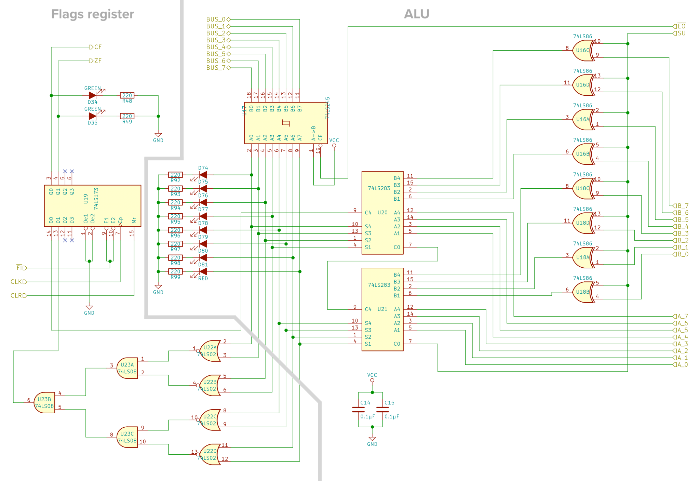
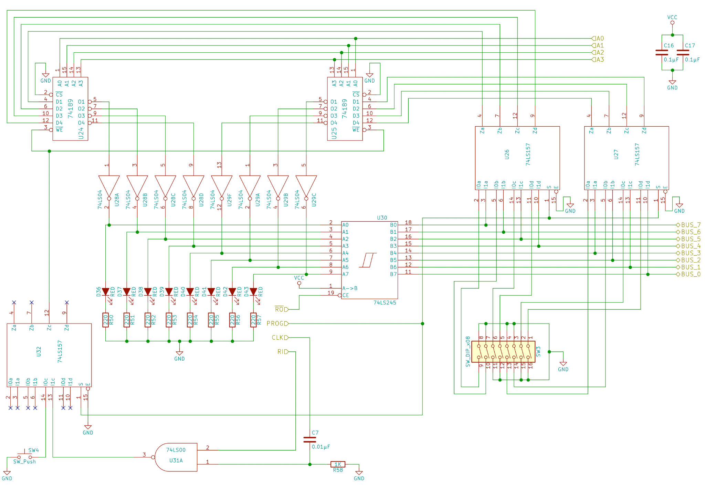
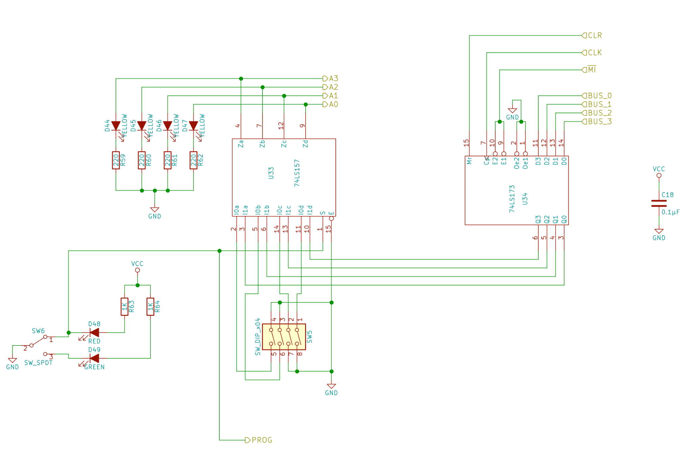

# 8 Bit Bilgisayar — ALU ve RAM Simülasyon Raporu

**Ders:** Tasarım 1  
**Hazırlayanlar:** Abdel Rahman Zidan ve Taha Deniz Akgül  
**Danışman:** Fatih Şenel  
**Konu:** 8 bit toplama/çıkarma birimi ve 16 × 8 bit bellek sistemi

## 1. Çalışmanın amacı ve kapsamı

Bu çalışmada, 8 bit bilgisayar projesinin aritmetik işlem ve bellek modülleri için hazırlanan devre şemaları incelenmiştir. İlk modül, iki adet 8 bit sayı üzerinde toplama ve çıkarma işlemlerini gerçekleştiren ALU devresidir. İkinci modül, verilerin adreslenerek yazılmasını ve okunmasını sağlayan RAM devresidir. Bellek adresini tutan MAR (Memory Address Register), RAM sisteminin tamamlayıcı alt birimi olarak ele alınmıştır.

Devreler, Ben Eater yaklaşımındaki ortak veri yolu ve ayrı kontrol sinyalleri temel alınarak düzenlenmiştir. Bu rapor, paylaşılan üç şema görüntüsüne dayanmaktadır. Çalıştırılabilir simülasyon dosyası, zaman diyagramı veya ölçüm kaydı rapora eklenmediğinden, aşağıdaki test tabloları **beklenen sonuçları** göstermektedir; ölçülmüş test sonuçları olarak değerlendirilmemelidir.

## 2. ALU: 8 bit toplama ve çıkarma birimi



*Şekil 1. Toplama/çıkarma devresi, veri yolu bağlantısı ve bayrak yazmacı.*

### 2.1. Kullanılan temel bileşenler

| Bileşen | Şemadaki referans | Görevi |
|---|---|---|
| 74LS283 | U20, U21 | İki adet 4 bit toplayıcı ile 8 bit aritmetik işlem |
| 74LS86 | U16, U18 | Çıkarma işleminde B girişinin bitlerini tersleme |
| 74LS245 | U17 | ALU sonucunu ortak veri yoluna aktarma |
| 74LS173 | U19 | Carry ve Zero bayraklarını saklama |
| 74LS02 | U22 | Sonuç bitleri üzerinde NOR işlemleri |
| 74LS08 | U23 | Sıfır algılama sonuçlarını birleştirme |
| LED ve dirençler | D34–D35, D74–D81 | Sonuç ve bayrakların görsel takibi |

### 2.2. Toplama işlemi

ALU, A ve B girişlerinden iki adet 8 bit veri alır. Düşük anlamlı dört bit bir toplayıcıya, yüksek anlamlı dört bit diğer toplayıcıya uygulanır. Alt grubun taşıma çıkışı üst grubun taşıma girişine bağlanarak 8 bitlik işlem elde edilir.

`SU = 0` olduğunda XOR kapıları B girişini değiştirmeden geçirir. Başlangıç taşıması sıfır olduğunda işlem şu şekildedir:

```text
Sonuç = A + B
8 bit çıkış = (A + B) mod 256
```

Örneğin, `00000101` (5) ile `00000011` (3) toplandığında beklenen çıkış `00001000` (8) olur. Sonuç 255 değerini aşarsa, alt sekiz bit sonuç çıkışında kalır ve son taşıma Carry bayrağı üzerinden izlenebilir.

### 2.3. Çıkarma işlemi

Şemadaki `SU` hattı XOR kapılarını ve düşük anlamlı toplayıcının taşıma girişini kontrol eder. `SU = 1` olduğunda B bitleri terslenir ve başlangıç taşıması 1 yapılır. Böylece ikiye tümleyen yöntemiyle çıkarma gerçekleştirilir:

```text
A − B = A + NOT(B) + 1    (8 bit modüler aritmetik)
```

Örneğin `00001001` (9) − `00000100` (4) işleminin beklenen sonucu `00000101` (5) olur. `3 − 5` işlemi ise sekiz bit çıkışta `11111110` üretir; bu desen işaretsiz yorumda 254, ikiye tümleyen yorumunda −2 anlamına gelir.

### 2.4. Sonucun veri yoluna aktarılması

Sonuç bitleri LED göstergelerine ve U17 veri yolu sürücüsüne bağlanmıştır. Şemada üst çizgiyle gösterilen `EO` kontrolü etkinleştirildiğinde ALU sonucu `BUS_0–BUS_7` hatlarına aktarılır. Çıkış devre dışı bırakıldığında sürücü veri yolunu serbest bırakmalıdır.

Ortak veri yolunda ALU ve RAM gibi birden fazla kaynak bulunduğu için aynı anda yalnızca bir çıkış sürücüsü etkin olmalıdır. ALU çıkışının etkinleştirilmesi aritmetik işlemin yapılmasını değil, hesaplanan sonucun veri yoluna bağlanmasını kontrol eder.

### 2.5. Carry ve Zero bayrakları

| Bayrak | Anlamı |
|---|---|
| CF — Carry Flag | Üst dört bitlik toplayıcının son taşıma çıkışını saklar |
| ZF — Zero Flag | Sekiz sonuç bitinin tamamı sıfır olduğunda 1 olur |

Şemada sonuç bitleri NOR kapılarıyla ikili gruplar halinde değerlendirilir. Bu ara sonuçlar AND kapılarıyla birleştirilerek sıfır algılama sinyali elde edilir. Bayraklar U19 üzerinden saklanır; `FI`, `CLK` ve `CLR` hatları yükleme, saat ve temizleme işlemleriyle ilişkilidir.

Çıkarma işleminde doğrudan son taşıma kullanıldığında `CF = 1`, işaretsiz karşılaştırmada borç oluşmadığını ifade eder. Carry bayrağı, işaretli sayı taşmasıyla aynı şey değildir; şemada ayrı bir işaretli taşma bayrağı gösterilmemiştir.

## 3. RAM: 16 × 8 bit bellek sistemi



*Şekil 2. RAM entegreleri, veri giriş seçimi, çıkış sürücüsü ve yazma kontrol devresi.*

### 3.1. Bellek organizasyonu

RAM bölümünde U24 ve U25 olmak üzere iki adet 74189 kullanılmıştır. Her entegre bir adresteki dört veri bitini tutar; ortak adres hatlarıyla birlikte kullanıldıklarında sekiz bitlik bir bellek sözcüğü elde edilir.

| Özellik | Değer |
|---|---|
| Adres hatları | A0–A3 |
| Adres sayısı | 2⁴ = 16 |
| Her adresteki veri | 8 bit = 1 bayt |
| Toplam kapasite | 16 × 8 = 128 bit = 16 bayt |
| Veri yolu | BUS_0–BUS_7 |

### 3.2. Kullanılan temel bileşenler

| Bileşen | Şemadaki referans | Görevi |
|---|---|---|
| 74189 | U24, U25 | İki adet 4 bit genişlikli bellek bankası |
| 74LS04 | U28, U29 | Terslenmiş bellek çıkışlarını tekrar tersleme |
| 74LS157 | U26, U27 | Yazılacak verinin kaynağını seçme |
| 74LS245 | U30 | Bellek verisini ortak veri yoluna aktarma |
| 74LS00 | U31A | Yazma kontrol mantığı |
| 74LS157 | U32 | Manuel/çalışma modu yazma kontrolü seçimine katılma |
| DIP anahtar | SW3 | Manuel veri girişi |
| Buton | SW4 | Manuel yazma komutu |
| LED ve dirençler | D36–D43 | Bellek çıkışının görsel takibi |

### 3.3. Veri yazma

U26 ve U27 çoklayıcıları, belleğe yazılacak sekiz bitlik veriyi iki kaynaktan seçer: ortak veri yolu veya SW3 DIP anahtarı. `PROG` hattı bu seçimi kontrol eder. Böylece program/veri elle girilebilir veya işlemci veri yolundan belleğe aktarılabilir.

Yazma işleminin temel sırası şöyledir:

1. Yazılacak bellek adresi A0–A3 hatlarına uygulanır.
2. Veri kaynağı seçilir ve sekiz bitlik veri hazırlanır.
3. Adres ve veri kararlı durumdayken yazma kontrolü etkinleştirilir.
4. Yazma sona erdirilir; adres ve veri gerekli süre boyunca korunur.
5. Aynı adres okunarak kaydedilen değer kontrol edilir.

Şemada `RI`, `CLK`, U31A, U32 ve SW4 yazma kontrol yolunda yer almaktadır. C7 ve R58 saat hattından geçici bir darbe oluşturmaya yönelik RC ağıdır. Gerçek yazma darbesinin süresi ve polaritesi, simülasyonda belleklerin `WE` girişleri üzerinden ayrıca gözlenmelidir.

### 3.4. Veri okuma

Seçilen adresteki veri, bellek entegrelerinin çıkışlarından alınır. Şemada terslenmiş çıkışlar 74LS04 kapıları üzerinden geçirilerek normal veri polaritesine çevrilir. Bu veri LED'lerle izlenebilir ve U30 üzerinden veri yoluna aktarılabilir.

Üst çizgiyle gösterilen `RO` kontrolü etkinleştirildiğinde bellek çıkışı veri yoluna bağlanır. `RO` pasifken U30 veri yolunu serbest bırakmalıdır. Bellek içeriğinin LED'lerde görülmesi ile veri yoluna aktarılması birbirinden ayrı işlevlerdir.

## 4. MAR: bellek adres yazmacı



*Şekil 3. Adres yazmacı, manuel adres anahtarları ve adres seçimi.*

MAR, erişilecek RAM adresini saklayan dört bitlik yazmaçtır. Bu bölümde U34 (74LS173), U33 (74LS157), SW5 DIP anahtarı ve SW6 mod seçme anahtarı bulunmaktadır.

Normal çalışma yolunda, veri yolunun dört hattından alınan adres U34'e yüklenir. `MI` yükleme kontrolü, `CLK` saat sinyali ve `CLR` temizleme sinyali yazmacın çalışmasını yönetir. U33 çoklayıcısı, RAM adresinin yazmaçtan mı yoksa manuel DIP anahtarından mı geleceğini seçer. Çıkış adresi A0–A3 hatlarıyla RAM bölümüne iletilir ve dört LED üzerinden izlenir.

Adresin yazmaçta tutulması, ortak veri yolu başka bir veri taşımaya başladığında RAM adresinin korunmasını sağlar. Entegrasyon sırasında `BUS_0–BUS_3`, yazmaç giriş/çıkışları ve A0–A3 arasındaki bit sırası tek tek kontrol edilmelidir; fiziksel pin sırası tek başına bit ağırlığını belirlemez.

## 5. Kontrol sinyalleri

Şemalarda üst çizgi veya girişte daire ile belirtilen sinyaller aktif düşük mantığı gösterir. Kontrol biriminin ürettiği seviyeler, ilgili entegre girişindeki etkin seviyeye göre değerlendirilmelidir.

| Sinyal | İlgili bölüm | İşlev |
|---|---|---|
| SU | ALU | Toplama/çıkarma seçimi |
| EO | ALU | ALU sonucunu veri yoluna verme |
| FI | Bayrak yazmacı | Bayrakları yükleme |
| RO | RAM | RAM verisini veri yoluna verme |
| RI | RAM | RAM yazma kontrol yolunu etkinleştirme |
| MI | MAR | Veri yolundan adres yükleme |
| PROG | RAM ve MAR | Manuel programlama/çalışma yolu seçimi |
| CLK | Yazmaçlar ve yazma kontrolü | İşlemlerin zamanlanması |
| CLR | Yazmaçlar | Yazmaçları temizleme; RAM içeriğinin silindiği anlamına gelmez |

## 6. Doğrulama planı ve beklenen sonuçlar

### 6.1. ALU testleri

Aşağıdaki bayrak değerleri, sonuç kararlı hale geldikten sonra bayrak yazmacına yükleme yapıldığı durum için verilmiştir. CF, doğrudan son taşıma çıkışı olarak yorumlanmıştır.

| İşlem | A | B | SU | Beklenen 8 bit sonuç | CF | ZF |
|---|---:|---:|---:|---|---:|---:|
| Basit toplama | 5 | 3 | 0 | 00001000 (8) | 0 | 0 |
| Alt gruptan üst gruba taşıma | 15 | 1 | 0 | 00010000 (16) | 0 | 0 |
| Sekiz bit sınırında taşıma | 255 | 1 | 0 | 00000000 (0) | 1 | 1 |
| Sıfır sonucu | 0 | 0 | 0 | 00000000 (0) | 0 | 1 |
| Basit çıkarma | 9 | 4 | 1 | 00000101 (5) | 1 | 0 |
| Eşit sayıları çıkarma | 5 | 5 | 1 | 00000000 (0) | 1 | 1 |
| Negatif sonuç deseni | 3 | 5 | 1 | 11111110 (−2 / 254) | 0 | 0 |

Ek olarak, EO pasifken ALU'nun veri yolunu sürmediği ve FI pasifken saklanan bayrakların değişmediği kontrol edilmelidir.

### 6.2. RAM ve MAR testleri

| Test | Uygulanacak işlem | Beklenen davranış |
|---|---|---|
| Temel yazma/okuma | 0011 adresine 00101101 yaz ve oku | Aynı adresten 00101101 okunur |
| Adres bağımsızlığı | 0011'e 00101101, 0100'a 10100101 yaz | Her adreste kendi verisi korunur |
| İlk ve son adres | 0000 ve 1111 adreslerine farklı veri yaz | Her iki sınır adresi doğru seçilir |
| Tüm adresler | 0–15 adreslerinin her birine adres numarasını yaz ve geri oku | Adres karışması olmadan 16 değer okunur |
| Veri bit sırası | Aynı adrese sırayla 01, 02, 04, 08, 10, 20, 40, 80 hex yaz | Her seferinde yalnızca ilgili veri biti 1 olur |
| Adres bit sırası | MAR'a sırasıyla 1, 2, 4 ve 8 yükle | A0, A1, A2 ve A3 sırasıyla etkinleşir |
| MAR tutma | Adres yükledikten sonra MI'yi pasifleştir ve veri yolunu değiştir | RAM adresi değişmez |
| Yazma engelleme | Yazma kontrolü pasifken giriş verisini değiştir | Önceden yazılmış veri korunur |
| Çıkış ayırma | RO'yu pasifleştir | RAM sürücüsü veri yolunu serbest bırakır |
| Mod seçimi | Manuel giriş ve veri yolu kaynağı arasında geçiş yap | Seçilen kaynağın adres/verisi kullanılır |

Manuel anahtarların açık konumunda girişlerin tanımlı mantık seviyesinde kaldığı ve gerekirse uygun pull-up/pull-down bağlantıları bulunduğu doğrulanmalıdır. Şemadaki etiketlerin yanında gerçek pin seviyeleri de izlenmelidir.

## 7. Modüllerin birlikte çalışması

RAM'deki iki değerin ALU'da toplanması için örnek veri akışı aşağıdaki gibidir. A ve B yazmaçları bu rapordaki görüntülerde yer almadığından, bu sıra sistem entegrasyonu için açıklayıcı bir örnektir.

1. İlk sayının adresi MAR'a yüklenir ve RAM çıkışı veri yoluna açılır.
2. Veri A yazmacına alınır; RAM çıkışı kapatılır.
3. İkinci adres MAR'a yüklenir ve ilgili veri B yazmacına alınır.
4. SU toplama konumuna getirilir; ALU sonucunun kararlı hale gelmesi beklenir.
5. Bayraklar yüklenir ve EO ile sonuç veri yoluna aktarılır.
6. Sonuç, hedef yazmaca veya uygun yazma sırasıyla RAM'e kaydedilir.

Her adımda veri yolunu süren kaynak, hedef yazmacın yükleme kontrolü ve saat sırası birlikte düzenlenmelidir.

## 8. Sonuç

Hazırlanan şemalar, 8 bit bilgisayarın aritmetik ve bellek alt sistemlerini kapsamaktadır. ALU bölümünde toplama, ikiye tümleyen ile çıkarma, sonuç gösterimi ve Carry/Zero bayraklarının saklanması yer almaktadır. Bellek bölümünde 16 bayt RAM, manuel veri girişi, veri yolu bağlantısı ve dört bitlik MAR ile adres seçimi bulunmaktadır.

Bir sonraki doğrulama aşamasında test tablolarındaki girişler uygulanmalı; sonuç bitleri, bayraklar, bellek yazma darbesi ve veri yolu sürücüleri kaydedilmelidir. Bu kayıtlar, devrelerin yalnızca yapısal olarak hazırlanmış olduğunu değil, beklenen işlevleri yerine getirdiğini de belgelemek için kullanılacaktır.

## Dosyalar

- [ALU devre şeması](images/alu.png)
- [RAM devre şeması](images/ram.png)
- [MAR devre şeması](images/mar.png)

Bu klasördeki `README.md` ve `images` klasörü birlikte GitHub'a yüklendiğinde görseller rapor içinde görüntülenir.
