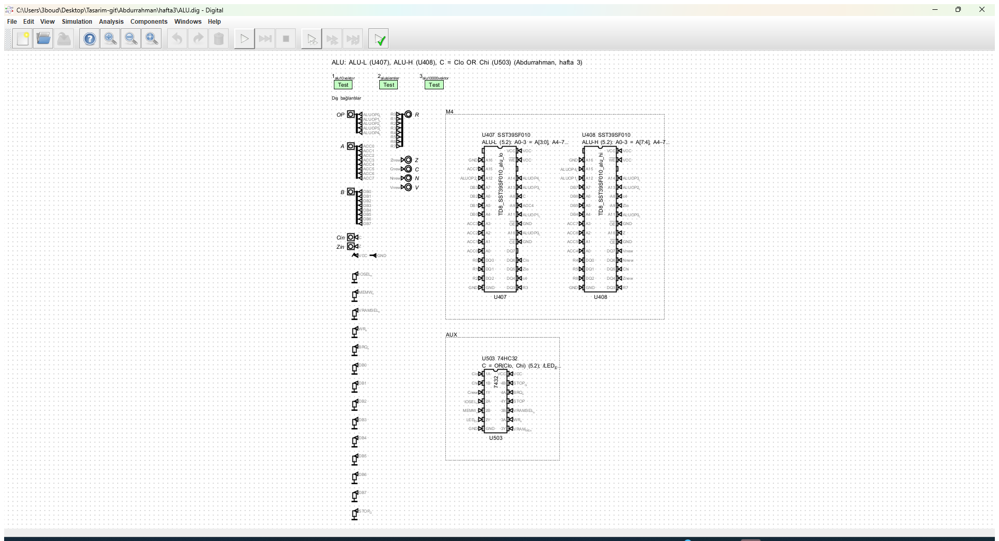
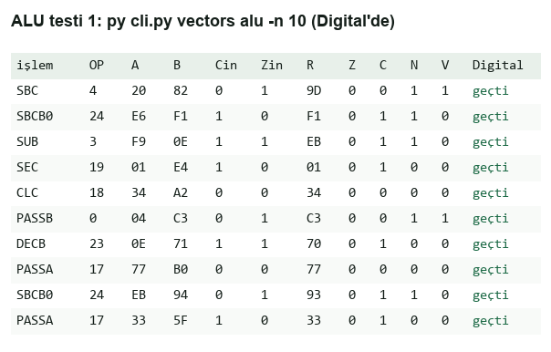
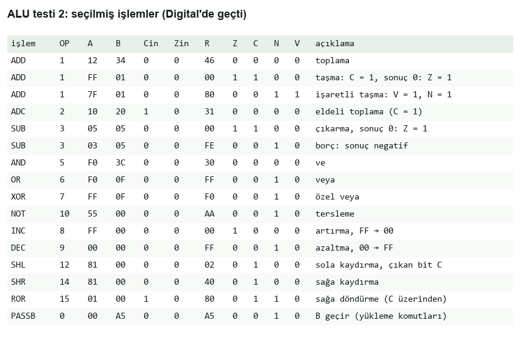
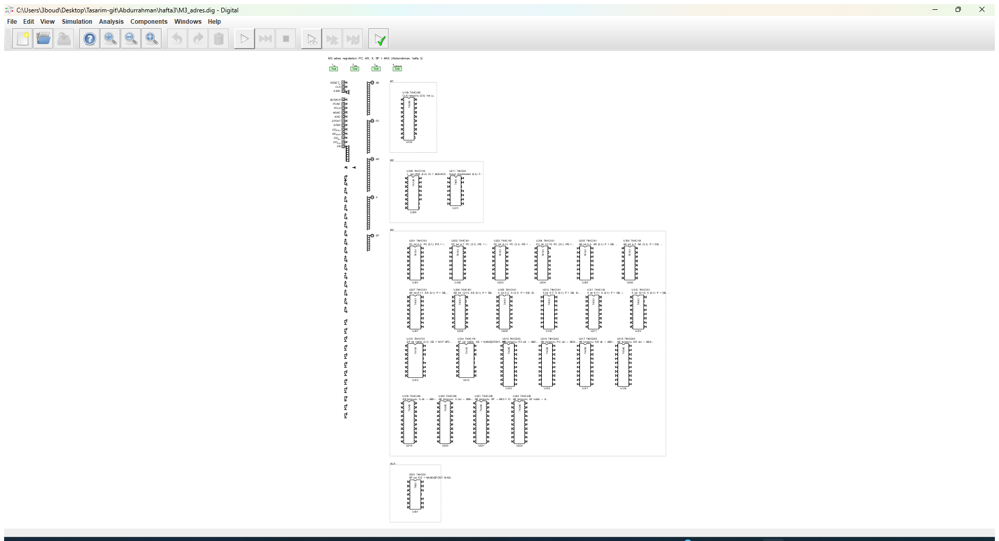
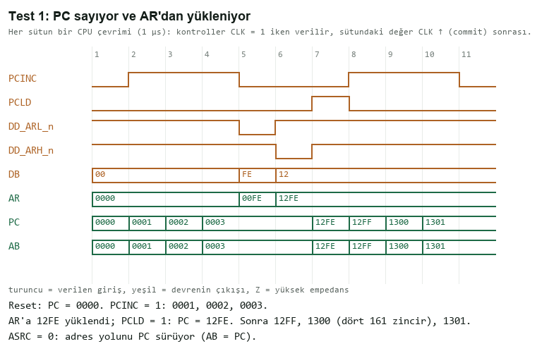
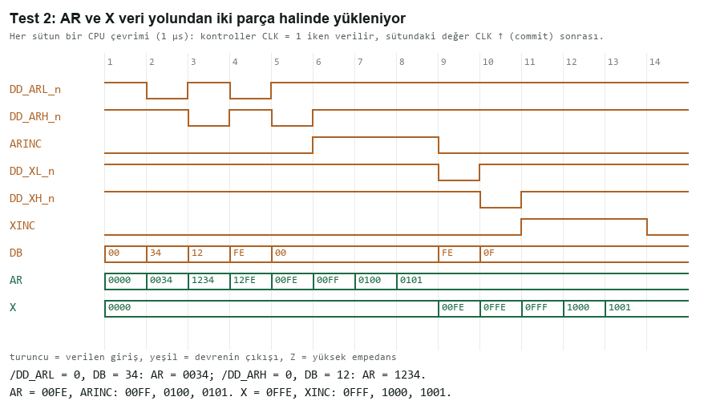
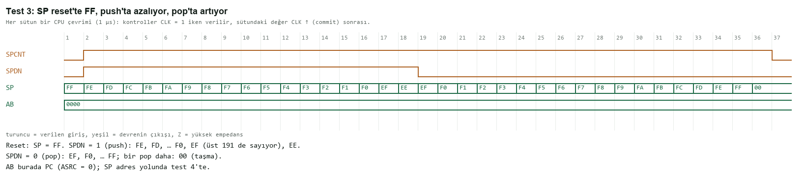
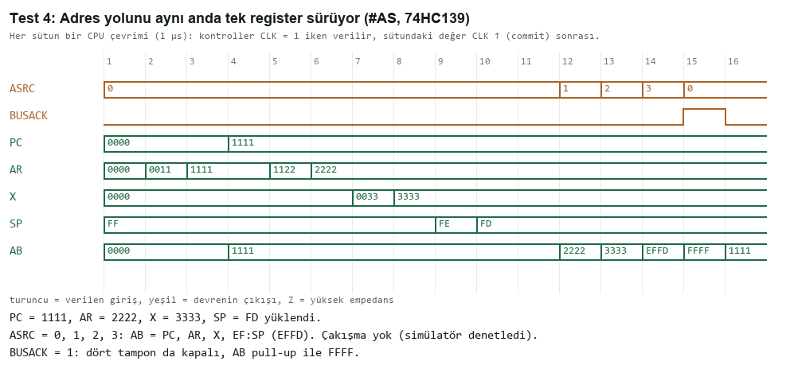

# Hafta 3 (10–16 Kasım 2026): ALU ve M3 adres registerları, Digital'de

Hazırlayan: Abdurrahman

> **Not:** Devre elle çizilmedi. `.dig` dosyası projenin netlist'inden (`sim/td8/hw/cpu.py`, Taha) Taha'nın Digital aracıyla (`sim/td8/hw/digital.py`) üretildi; bağlantılar `sim/digital/` altındaki dosyalarla aynı. Bu klasörde benim eklediklerim: testler, dalga şekilleri, ekran görüntüleri ve bu rapor.

## Özet

- İlk sürümdeki ALU, RAM ve MAR şemaları SAP-1 yapısındaydı (74LS283 toplayıcı, 16 baytlık RAM, 4-bit MAR). TD-8 planında bu parçalar farklı; plana göre **Digital'de yeniden kuruldu** (18 Kasım):
  - **ALU:** toplayıcı entegresi yok; ALU **iki flash'ta tablo** (SST39SF010, ALU-L ve ALU-H), 25 işlem ve dört bayrak (Z, C, N, V). [SISTEM-PLANI 5.2–5.3](../../SISTEM-PLANI.md)
  - **MAR yok:** adres yolunu dört register sürüyor: **PC, AR, X, SP** (M3). AR, MAR'ın işini görüyor ama 16 bit ve sayabiliyor. [SISTEM-PLANI 5.1](../../SISTEM-PLANI.md)
  - **RAM** (CY62256, 32 KB) M5'in parçası; Taha'da, Digital'de test edildi. Bu klasörde yok.
- İki devre dosyası, **7 testin yedisi de Digital'de geçti** (ALU'da 10.000 rastgele vektör dahil).

## Dosyalar

| Dosya | İçerik |
|---|---|
| `ALU.dig` | ALU devresi (U407, U408, U503) + 3 test |
| `TD8_SST39SF010_alu_lo.dig`, `TD8_SST39SF010_alu_hi.dig` | İki flash'ın alt devreleri; ALU tabloları içlerine gömülü (`ALU.dig` bunları kullanıyor, aynı klasörde durmalı) |
| `M3_adres.dig` | M3 devresi (U301–U322 + U109, U209, U211, U501) + 4 test |
| `images/alu_digital_ekran.png`, `images/m3_digital_ekran.png` | Devrelerin Digital'deki ekran görüntüleri |
| `images/alu_devre.svg`, `images/m3_devre.svg` | Devrelerin tamamı, Digital'den SVG |
| `images/alu_1_10_vektor.png`, `alu_2_islemler.png` | ALU test tabloları |
| `images/m3_1_PC.png` … `m3_4_adres_yolu.png` | M3 testlerinin dalga şekilleri |
| `images/*_digital_test_ciktisi.txt` | Digital komut satırı test çıktıları |

---

## 1. ALU (2 flash'ta tablo)



| Entegre | Görev | Bağlantı |
|---|---|---|
| U407 SST39SF010 | **ALU-L**: alt 4 bit | A0–3 = A[3:0], A4–7 = DB[3:0], A8 = C, A9 = A[4], A10–14 = ALUOP[4:0], A15 = A[7], A16 = 0. D0–3 = R[3:0], D4 = c4, D5 = Zlo, D6 = Clo |
| U408 SST39SF010 | **ALU-H**: üst 4 bit + bayraklar | A0–3 = A[7:4], A4–7 = DB[7:4], A8 = c4, A9 = Zlo, A10 = Z, A11–15 = ALUOP[4:0], A16 = 0. D0–3 = R[7:4], D4 = Znew, D5 = Chi, D6 = Nnew, D7 = Vnew |
| U503 74HC32 (1. kapı) | Carry birleştirme | Cnew = Clo OR Chi |

- ALU'nun sol girişi A registerı (ACC0–7), sağ girişi doğrudan veri yolu (DB0–7). İşlem kodu kontrol kelimesinin ALUOP alanı (5 bit).
- Flash içerikleri `sim/td8/alu.py`'nin ürettiği tablolar (`py gen_roms.py` → `build/alu_lo.bin`, `alu_hi.bin`); Digital dosyasına gömüldü, ayrıca dosya yüklemek gerekmiyor.
- Bacak bağlantıları [TD8-baglanti-tablosu.md](../../Tahadan-Abdurrahmana/TD8-baglanti-tablosu.md) bölüm M4 (U407, U408) ve AUX (U503) ile birebir aynı.

### Test 1: `py cli.py vectors alu -n 10` (Taha'nın istediği 10 satır)

Her satırda girişler (OP, A, B, Cin, Zin) verildi; çıkışların (R, Z, C, N, V) tabloyla aynı olduğu Digital'de denetlendi.



### Test 2: Seçilmiş işlemler

Bayrakların sınır durumları: taşma (C), sıfır (Z), işaretli taşma (V), negatif (N), kaydırmada çıkan bit.



### Test 3: 10.000 rastgele vektör

`py cli.py vectors alu -n 10000` ile aynı tablo (25 işlem, rastgele A, B, C, Z). Digital'de satır satır denendi: **geçti**.

```
> java -cp Digital.jar CLI test -circ ALU.dig
1_alu_10_vektor: passed
2_alu_islemler: passed
3_alu_10000_vektor: passed
```

---

## 2. M3 adres registerları (PC, AR, X, SP)



| Register | Entegreler | Bağlantı |
|---|---|---|
| **PC** (16 bit) | U301–U304 74HC161, U315–U316 74HC245 (→ AB) | CP = CLK_PC, /MR = /RESET_s. Sayma CEP = PCINC (TC → bir üstün CET). Yükleme /PE = /PCLD, girişler **AR'ın çıkışı**. PC'nin DB tamponları (U405, U406) M4'te |
| **AR** (16 bit) | U305–U308 74HC161, U317–U318 74HC245 | CP = CLK_AR. Girişler DB; alt bayt /PE = /DD_ARL, üst bayt /PE = /DD_ARH. Sayma CEP = ARINC. Çıkış → PC girişi ve AB |
| **X** (16 bit) | U309–U312 74HC161, U319–U320 74HC245 | AR ile aynı yapı: /DD_XL, /DD_XH, XINC. Çıkış yalnız AB |
| **SP** (8 bit, `EF` sayfası) | U313–U314 74HC191, U321–U322 74HC245 | Yukarı/aşağı sayıcı. D = FF, /PL = /RESET_s (reset'te FF). Alt çip /CE = /SPCNT, üst çip /CE = NAND(SPCNT, MAX/MIN_alt) (U501). D/U = SPDN (1 = push, aşağı). AB[7:0] = SP, AB[15:8] = sabit EF (U322 girişleri) |

Testin tam olması için devreye komşu modüllerden 4 entegre de eklendi:

| Entegre | Neden |
|---|---|
| U109 74HC245 (M1) | CLK tamponu: CLK_PC, CLK_AR, CLK_X, CLK_SP dalları |
| U209 74HC139 (M2) | **#AS adres yolu seçicisi**: ASRC = 0, 1, 2, 3 → /AB_PC, /AB_AR, /AB_X, /AB_SP; /G = BUSACK |
| U211 74HC04 (M2) | PCLD → /PCLD, SPCNT → /SPCNT |
| U501 74HC00 (AUX) | /SPCNT_HI = NAND(SPCNT, SP_MM0) |

Adres yolunda 16× 10k pull-up var: hiçbir tampon sürmediğinde AB = FFFF.

Her CPU çevrimi testte 3 satır: kontroller CLK = 1 iken verilir (74HC191'in /CE ve D/U kuralı: yalnız CP yüksekken değişmeli), CLK = 0, CLK ↑ (commit). Dalga şekillerinde her sütun bir çevrim; değerler commit'ten sonra.

### Test 1: PC sayıyor ve AR'dan yükleniyor

| Ne verildi | Ne bekleniyordu | Ne görüldü |
|---|---|---|
| Reset | PC = 0000, SP = FF | PC = 0000, SP = FF |
| PCINC = 1, 3 çevrim | 0001, 0002, 0003 | 0001, 0002, 0003 |
| AR'a 12FE (iki bayt), PCLD = 1 | PC = 12FE | PC = 12FE |
| PCINC = 1, 3 çevrim | 12FF, 1300 (161 zinciri FF → 00 taşıyor), 1301 | 12FF, 1300, 1301. AB = PC (ASRC = 0). **Geçti** |



### Test 2: AR ve X veri yolundan iki parça halinde

| Ne verildi | Ne bekleniyordu | Ne görüldü |
|---|---|---|
| /DD_ARL = 0, DB = 34; /DD_ARH = 0, DB = 12 | AR = 0034, sonra 1234 | 0034, 1234 |
| AR = 00FE, ARINC = 1, 3 çevrim | 00FF, 0100, 0101 | 00FF, 0100, 0101 |
| X = 0FFE (/DD_XL, /DD_XH), XINC = 1, 3 çevrim | 0FFF, 1000, 1001 | 0FFF, 1000, 1001. **Geçti** |



### Test 3: SP reset'te FF, push'ta azalıyor, pop'ta artıyor

| Ne verildi | Ne bekleniyordu | Ne görüldü |
|---|---|---|
| Reset | SP = FF | FF |
| SPDN = 1 (push), SPCNT = 1, 17 çevrim | FE, FD, … F0, **EF** (üst 191 de azalıyor), EE | FE … F0, EF, EE |
| SPDN = 0 (pop), SPCNT = 1, 17 çevrim | EF, **F0** (üst 191 artıyor), … FF | EF, F0 … FF |
| Bir pop daha | 00 (taşma) | 00. **Geçti** |



### Test 4: Adres yolunu aynı anda tek register sürüyor

| Ne verildi | Ne bekleniyordu | Ne görüldü |
|---|---|---|
| PC = 1111, AR = 2222, X = 3333, SP = FD yüklendi | | |
| ASRC = 0, 1, 2, 3 | AB = 1111, 2222, 3333, EFFD | 1111, 2222, 3333, EFFD |
| BUSACK = 1 | Dört tampon kapalı, AB pull-up ile FFFF | FFFF. **Geçti** |

Projenin çip seviyesi simülatörü (`sim/td8/hw/`) her adımda iki çipin aynı hatta aynı anda çıkış vermesini (bus çakışması) denetliyor: testler boyunca çakışma yok. Tek istisna açılışın ilk 18 ns'si: 74HC139'un çıkışları henüz oturmadan tamponlar kısa bir an birlikte açık görünüyor (gerçek devrede de açılışta olur, reset sürerken önemsiz).



```
> java -cp Digital.jar CLI test -circ M3_adres.dig
1_PC: passed
2_AR_X: passed
3_SP: passed
4_adres_yolu: passed
```

---

## Sınırlar ve sonraki adımlar

- Digital gecikmeleri modellemez: burada yalnız işlev doğrulandı (zamanlama projenin çip seviyesi simülatöründe).
- LED'ler (PC, AR, X 16'şar, SP 8) ve kondansatörler simülasyonda yok; breadboard ve KiCad şemasında eklenecek.
- Gerçek flash'larda (SST39SF010) ALU tabloları T48 programlayıcıyla yazılacak (`build/alu_lo.bin`, `alu_hi.bin`).
- Sıradaki (4. hafta): bütün işlemcinin birleştirilmesi (Taha ile).
