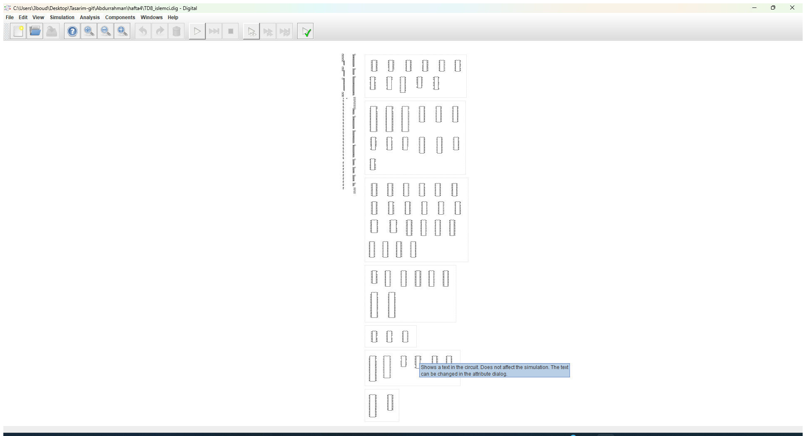
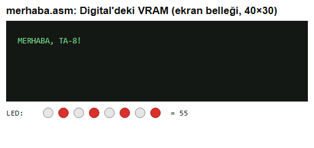
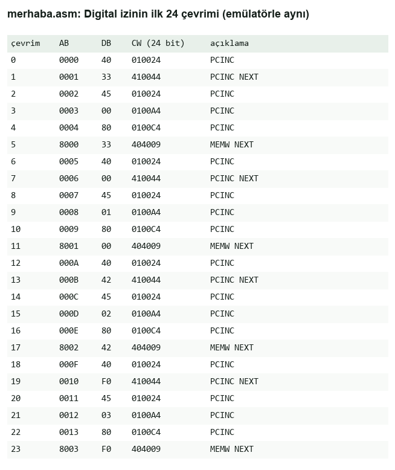
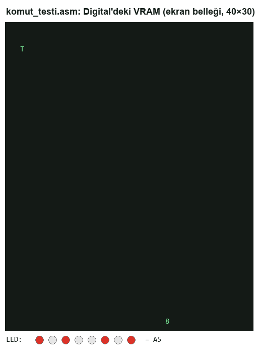
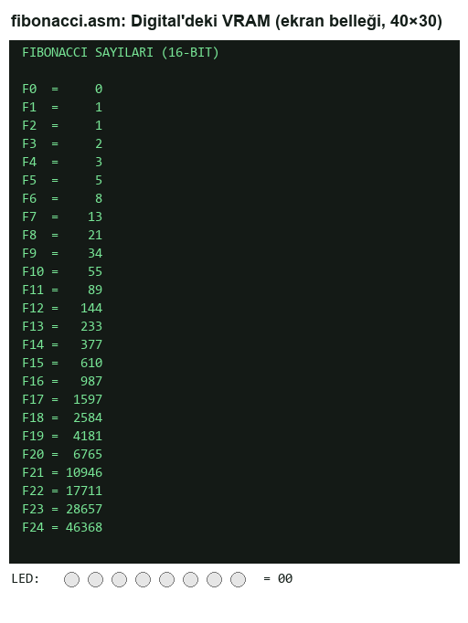

# Hafta 4 (17–23 Kasım 2026): Bütün işlemci Digital'de, emülatörle sıfır fark

Hazırlayan: Abdurrahman

> **Not:** Devre elle çizilmedi. `.dig` dosyası projenin netlist'inden (`sim/ta8/hw/cpu.py`, Taha) Taha'nın Digital aracıyla (`sim/ta8/hw/digital.py`) üretildi; bağlantılar `sim/digital/` altındaki dosyalarla aynı. Bu klasörde benim eklediklerim: testler, dalga şekilleri, ekran görüntüleri ve bu rapor.

## Özet

- Modüller tek devrede birleştirildi: hafta 1–3'te test ettiğim M1, M3, M4 ve Taha'nın M2 (kontrol ünitesi) ile M5 (bellek) modülleri, yardımcı kapılarla birlikte. Bu, Taha'nın `sim/digital/ta8.dig` dosyasıyla aynı devre; Taha bu karşılaştırmayı daha önce yapmıştı (`sim/README.md`), burada aynı araçla yeniden koşturulup belgelendi. **63 entegre** + henüz olmayan VGA/klavye (M6, M7) için 2 taklit.
- Üç program Digital'de koşturuldu ve emülatörle (`MicroEmu`) **çevrim çevrim** karşılaştırıldı: her çevrimde adres yolu, veri yolu ve 24 bitlik kontrol kelimesi; sonunda LED, RAM ve ekran belleği.
- **Üçünde de sıfır fark.** Bu, ikinci kilometre taşı **K2 (CPU Digital'de sıfır farkla çalışıyor)**.

| Program | Ne yapıyor | Çevrim (Digital / emülatör) | Sonuç |
|---|---|---:|---|
| `merhaba.asm` | Ekrana yazı yazar, LED = 55, HALT | 573 / 573 | **Sıfır fark** |
| `komut_testi.asm` | 88 opcode'un hepsi, 14 dallanma, stack, CALL/RET, I/O; hata yoksa LED = A5 | 796 / 796 | **Sıfır fark**, LED = A5 (hatasız) |
| `fibonacci.asm` | 16-bit Fibonacci F0–F24, çarpma/bölme kütüphanesiyle ekrana yazdırma | 33.170 / 33.170 | **Sıfır fark** |

## Dosyalar

| Dosya | İçerik |
|---|---|
| `TA8_islemci.dig` | Bütün işlemci (program ROM'unda `merhaba.asm`) |
| `TA8_SST39SF010_*.dig`, `TA8_CY62256.dig` | Bellek alt devreleri: 3 mikrokod ROM'u, 2 ALU flash'ı, program ROM'u, RAM (içerikler gömülü; `TA8_islemci.dig` ile aynı klasörde durmalı) |
| `images/ta8_islemci_digital_ekran.png` | Devrenin Digital'deki ekran görüntüsü |
| `images/ta8_islemci_devre.svg` | Devrenin tamamı, Digital'den SVG (yakınlaştırılabilir) |
| `images/merhaba_ekran.png`, `komut_testi_ekran.png`, `fibonacci_ekran.png` | Programlar bittiğinde Digital'deki ekran belleği (VRAM) ve LED'ler |
| `images/merhaba_iz.png` | `merhaba.asm`'nin Digital izinin ilk 24 çevrimi |
| `images/*_ekran.txt`, `images/sonuclar.json` | Ekran belleğinin metni ve karşılaştırma sonuçları |

## Devre

| Modül | Entegre | Kimde | Ayrı test |
|---|---:|---|---|
| M1 saat / reset / durdurma | 11 | Abdurrahman (test) | [hafta1](../hafta1/README.md) |
| M2 kontrol ünitesi (3 mikrokod ROM'u, kontrol latch'i, kod çözücüler, adım sayacı, breakpoint) | 13 | Taha | Taha'nın 4. hafta raporu |
| M3 adres registerları (PC, AR, X, SP) | 22 | Abdurrahman (test) | [hafta3](../hafta3/README.md) |
| M4 A, IR, F, ALU flash'ları, DB tamponları | 8 | Abdurrahman (test) | [hafta2](../hafta2/README.md), [hafta3](../hafta3/README.md) |
| AUX yardımcı kapılar | 3 | ortak | |
| M5 program ROM'u, RAM, adres çözme, LED ve durum portu | 6 | Taha | Taha'nın 4. hafta raporu |
| TB: VGA (M6) ve klavye (M7) yerine taklit (VRAM, PS/2) | 2 | | M6 ve M7 Aralık'ta |

Bütün bağlantılar [TA8-baglanti-tablosu.md](../../Tahadan-Abdurrahmana/TA8-baglanti-tablosu.md) ile aynı. Modüller net adlarıyla (ör. `CLK`, `DB0–7`, `/OE_A`) birbirine bağlanıyor; hafta 1–3'teki modül dosyalarında kullanılan adların aynısı.

## Nasıl test edildi

1. Program assembler ile çevrildi, program ROM'una gömüldü.
2. Digital komut satırından adım adım çalıştırıldı: 6 MCLK reset, sonra her MCLK. Her commit kenarında (CLK ↑) **AB, DB ve CW** kaydedildi (projenin `sim/ta8/hw/digital_cpu.py` aracıyla, `py cli.py hw digital --run` ile aynı).
3. Aynı program mikroadım emülatöründe (`sim/ta8/emu_micro.py`) çalıştırıldı; iki iz satır satır karşılaştırıldı. HALT'ta ikisinin LED, RAM (8000–EFFF) ve VRAM içerikleri de karşılaştırıldı.

### `merhaba.asm`

İzin ilk 24 çevrimi (Digital'den; emülatörün izi aynı). Program `LDA #`, `STA` ile pointer'ları RAM'e (8000–8003) yazıyor: her `STA` çevriminde AB = 800x ve MEMW kontrol biti 1.

### `komut_testi.asm`

Komut setinin 88 opcode'unun hepsini çalıştırıyor; her sonucu RAM'e yazıp kendisi denetliyor. Hata yoksa LED = **A5**: Digital'de A5.

### `fibonacci.asm`

33.170 çevrim (1 MHz'de ~33 ms). 16-bit toplama, çarpma/bölme kütüphanesi (`lib/runtime.asm`) ve ekrana yazdırma.

## Sınırlar ve sonraki adımlar

- Digital gecikmeleri modellemez: burada yalnız işlev doğrulandı. Zamanlama (ör. WAIT payı ~3 ns) projenin çip seviyesi simülatöründe ve prototiplerde ölçülecek.
- VGA (M6) ve PS/2 klavye (M7) henüz taklit; Aralık'ta (hafta 5–7).
- **Prototip a** (saat modülü breadboard'da, osiloskopla WAIT zamanlaması): parçalar gelince.
- Sıradaki (hafta 5): M6 VGA zamanlaması.
