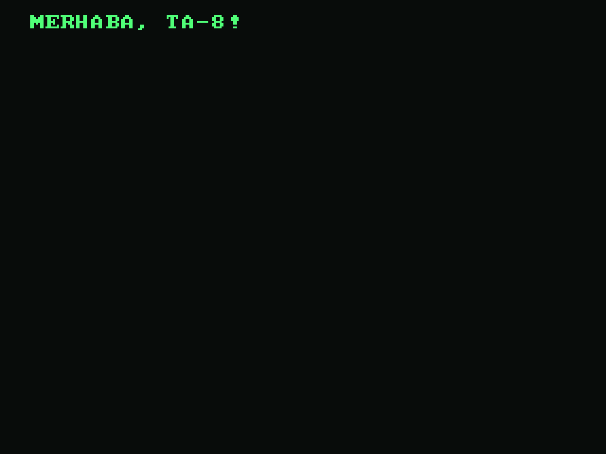
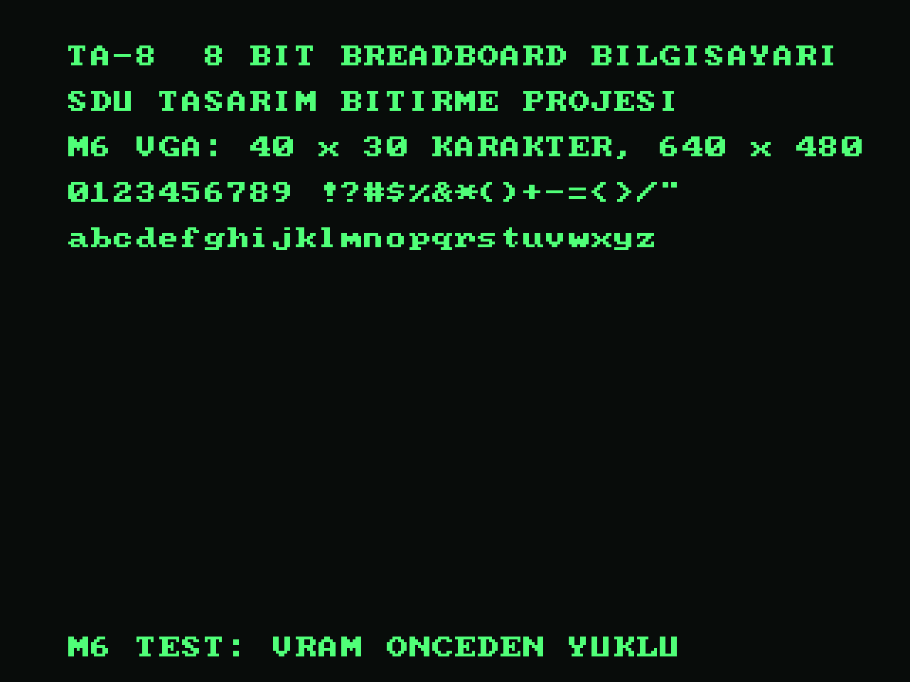
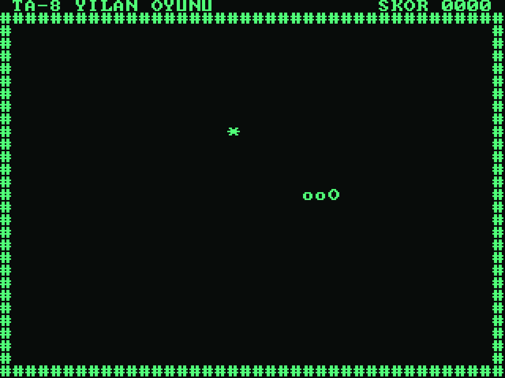
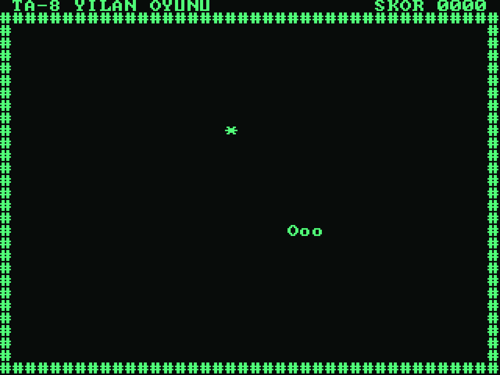

# Hafta 5.1 (24–30 Kasım 2026): M6 ve M7 netlist'te, KiCad şemaları, malzeme listesi

Hazırlayan: Abdurrahman

## Özet

- **M6'nın tamamı ana netlist'te (19/19 entegre):** `sim/ta8/hw/cpu.py` `m6_vga()`. Zamanlama (U701–U711, `hafta5/m6_uret.py`'den taşındı) + karakter hattı (U712–U719): 3× 74HC157, VRAM, DB tamponu, font ROM'u, 74HC166, çıkış katı. VRAM taklidi X1 kalktı.
- **Devrenin görüntüsü nokta nokta doğru:** VIDEO çıkışı her DCLK'de yakalanıyor; 480 × 320 noktanın hepsi VRAM + font ROM'undan hesaplanan görüntüyle aynı (`sim/ta8/hw/screen.py`).
- **Gerçek font:** `font8x8_basic` (kamu malı) `sim/fonts/`'ta; `vga.default_font()`, `py cli.py roms` ve M6 artık bunu kullanıyor (test deseni: `--test-font`).
- **Bulgu:** pencerede /BUFEN kapalıyken VD0–7 yüzüyordu (font ROM'unun girişleri boşta). 10k pull-down SIP dizisi eklendi (planda yok).
- **CPU + M6 birlikte çalışıyor:** `merhaba.asm`, gerçek 25 MHz VGA zamanlamasıyla, emülatörle **sıfır fark**. CPU, M6'nın açtığı VRAM penceresini ~15,4 ms bekliyor; "MERHABA, TA-8!" VRAM'e 482–522. satırlar arasında yazılıyor, pencere dışında yazma yok.
- **VWR senkronlayıcısı kuruldu:** M1'deki U111'in boş iki flip-flop'u VWR'yi (T1 Q7) iki MCLK ile VWR_s'e çeviriyor (plan 3.6).
- **M7 PS/2 klavye netlist'te (6/6 entegre + 2N7000, 2× 1N4148, RC):** `cpu.m7_ps2()`, `build(kbd='netlist')`. Gerçek PS/2 çerçeveleri (sanal klavye, `ta8/hw/ps2.py`) KCLK/KDATA'dan; `klavye.asm` CPU + M7 ile emülatörle **sıfır fark**. CPU + M6 + M7 birlikte de sıfır fark.
- **Snake bütün sistemde çalışıyor:** CPU + M6 + M7 çip seviyesinde, oyun döngüsü 34 tur (43 VGA karesi), 13 hamle, iki ok tuşu sanal klavyeden; emülatörle **sıfır fark**, 43 karenin hepsi VRAM'le nokta nokta aynı.
- **Bütün sistem netlist'te:** plan 92 entegre, netlist 88; eksik 4'ü bilinen (M1: NE555, 74HC153, 74HC14; AUX: gereksiz kalan 74HC00).
- **KiCad şemaları** netlist'ten üretiliyor: `py cli.py hw kicad` → `sim/kicad/`, PDF: [TA8_semalar.pdf](TA8_semalar.pdf).
- **Malzeme listesi:** [BOM.md](BOM.md), LCSC'ye yüklenecek dosya [BOM-lcsc.csv](BOM-lcsc.csv).

## 1. İki kip: `build(vga=...)`

| Kip | M6 | VWR_s | VRAM | Hız | Kullanım |
|---|---|---|---|---|---|
| `'taklit'` (varsayılan) | yok | test tezgâhından | X1 taklidi | hızlı | sıfır fark testleri, Digital dosyaları |
| `'netlist'` | U701–U719, OSC25 = 25 MHz | U111 FF2/FF3, VWR'den | U715 | ~25 kat yavaş | M6 testleri, KiCad, bağlantı tablosu |

```
HwCpu(prog.image, vga='netlist')      # test tezgâhı
cpu.build(vga='netlist')               # yalnız netlist
```

Pencere kapalıyken WAIT bir kareye (16,8 ms) kadar sürebildiği için `HwCpu.run()`'ın "takıldı" sınırı netlist kipinde 5 ms'den 20 ms'ye çıktı.

## 2. Sonuçlar

| Test | Sonuç |
|---|---|
| merhaba.asm, CPU + M6, emülatörle karşılaştırma | sıfır fark, 573 çevrim, HALT |
| VRAM yazmaları | 14, hepsi satır 482–522 arasında; pencere dışında 0 |
| WAIT ile bekleme | 15,4 ms (açılışta kare 0, pencere satır 482'de açılıyor) |
| M6 ile CPU'nun ortak netleri | yalnız VWR ve SLOW (istenmeyen çakışma yok) |
| Yalnız M6, VRAM'de 3 satır yazı + çerçeve, 2 kare | 480 × 320 noktanın hepsi beklenen görüntüyle aynı |
| CPU + M6, merhaba.asm | yazmalardan sonraki kare beklenen görüntüyle aynı, ilk kare boş |
| Entegre sayımı (M6) | plan 19, netlist 19, açıklanmamış fark 0 |



*CPU + M6: `merhaba.asm` "MERHABA, TA-8!" yazısını VRAM'e yazıyor, M6 sonraki karede çiziyor. Görüntü devrenin VIDEO çıkışından nokta nokta alındı (gerçek font: `font8x8_basic`, kamu malı, `sim/fonts/`).*



*Yalnız M6: VRAM'e önceden yazı yüklendi (CPU yok); büyük/küçük harf, rakam ve işaretler.*

### Zamanlama ihlalleri

| İhlal | Ne zaman | Sonuç |
|---|---|---|
| VD0–7 yüzüyor (font ROM'u) | pencerede /BUFEN kapalıyken | **Düzeltildi:** 10k pull-down |
| U715/U716 çakışma ~650 ns | açılış, T1 ilk değerini yüklemeden | Gerçekte de olabilir (377 rastgele açılır), < 1 µs, zararsız |
| U718 (166) setup | yalnız VMUX penceresinde (satır ≥ 480) | VD orada DB'yi izliyor; çıkış BLANK_n = 0 ile kapalı, ekranda etkisi yok (test ediliyor) |
| U404/U601 vb. çakışmalar | CPU, M6'sız da aynı sayıda | Eski, bilinen devir-teslim (~11 ns) |

Testler: `sim/tests/test_m6_netlist.py` (12 test), `test_m7_netlist.py` (10 test), `test_kicad.py` M6 ve M7 dahil kartla.

## 3. M7 PS/2 klavye

| Parça | Görev |
|---|---|
| U801 74HC14 | KCLK (iki kez terslenir → 164 saati, yükselen kenar), KDATA → /KDATA, KBD_RD, zaman aşımı eşiği |
| U802, U803 2× 74HC164 | Kaydırma; start biti 1 olarak girer, 11. kenarda U803 Q2'ye gelir → **KRDY** |
| U804 74HC540 | F800 okunurken byte'ı DB'ye koyar (tersleyerek gerçek değer) |
| U805 74HC74 + U806 74HC08 | KCLR: okuma çevriminin commit'inde bir çevrimlik temizleme darbesi |
| D801, D802, Q801 | KRDY veya KCLR → 2N7000 KCLK'ı düşük tutar (susturma): klavye bekler, byte kaybolmaz |
| RC801 | 22k / 10 nF: KCLK ~190 µs yüksek kalırsa yarım çerçeveyi atar |

Yeni modeller: `ta8/hw/discrete.py` (2N7000, 1N4148, RC zaman aşımı; entegre sayımına girmez), `ta8/hw/ps2.py` (açık akaç sanal klavye, 12.5 kHz, PS/2 kuralları: 50 µs boşta bekleme, tek eşlik). Emülatör karşılaştırmasında KRDY ve VWR_s devreden oynatılıyor (`harness.ReplayBus`).

| Test | Sonuç |
|---|---|
| Yalnız M7: 6 byte (00, FF dahil), CPU 250 µs geç okuyor | hepsi doğru; beklerken KCLK düşük (susturma), okumadan sonra KRDY = 0 ve KCLK bırakılıyor; ihlal yok |
| Yarım çerçeve, sonraki byte ≥ 200 µs sonra | zaman aşımı atıyor, sonraki byte doğru |
| Zaman aşımı zorla kapalı (kontrol) | sonraki byte bozuluyor: test gerçekten zaman aşımını ölçüyor |
| klavye.asm, CPU + M7, 5 tuş | sıfır fark, ekranda `1C F0 1C 29 5A`, LED = 5A |
| klavye.asm, CPU + M6 + M7 | sıfır fark |

**Bulgu (karar ikimizin):** PS/2 cihazı 50 µs boşluktan sonra gönderebilir, zaman aşımı ise 190 µs. Yarım kalan bir çerçeveden < 190 µs sonra gelen byte bozuluyor (50/100/150 µs: bozuk; 200/300 µs: doğru). Yarım çerçeve nadir (tak-çıkar, gürültü). Kısaltmak mümkün: 22k / 4.7 nF ≈ 90 µs (saatin en uzun yüksek süresi 50 µs, 10 kHz'de; ondan kısa olamaz). Test bu sınırlamayı belgeliyor (`test_finding_fast_frame_after_partial_corrupts`).

**Plan ayrıntısı:** kaydırma KCLK'nın yükselen kenarında olmalı (plan da böyle yazıyor). Düşen kenarda olsaydı zaman aşımı boşta etkin olduğu için her çerçevenin start biti silinirdi.

## 4. Snake bütün sistemde (CPU + M6 + M7)

`snake.c` (C, tacc), `HIZ_BAS=2` ile (2 turda bir hamle), çip seviyesindeki netlist'in tamamında: 88 entegre + ayrık parçalar, 25 MHz VGA saati, gerçek PS/2 çerçeveleri. Yeniden üretmek: `py -3 Abdurrahman/hafta5.1/snake_netlist.py` (~5 dk).

| Ölçüm | Sonuç |
|---|---|
| Süre | 730 ms simülasyon (571.201 çevrim): oyunun ana döngüsü 34 tur, ekranda 43 VGA karesi (her biri 16,8 ms) |
| Başlangıç | 9. turda (≈ 18. VGA karesi) VRAM temizleniyor, duvarlar çiziliyor; ilk hamle 10. turda |
| Tuşlar | 22. turda ↓ (≈ 32. VGA karesi), 28. turda ← (≈ 38. VGA karesi); ikisi de M7'den geçip oyuna ulaşıyor |
| Emülatörle karşılaştırma | **sıfır fark**; 13 hamle ikisinde de; son VRAM aynı |
| Görüntü | 43 VGA karesinin hepsi, kendinden önceki pencerenin sonundaki VRAM'le nokta nokta aynı |
| İhlaller | 31 açılışta; 98.381 bilinen devir-teslim (U404/U601 vb., ~11 ns); 1.588 U718 setup, hepsi görüntüsüz satırlarda; başka yok |



*VGA karesi 30: yılan sağa gidiyor (`ooO`).*



*VGA karesi 42: ↓ ve ← tuşlarından sonra yılan üç satır aşağıda, sola gidiyor (`Ooo`). İki görüntü de devrenin VIDEO çıkışından.*

## 5. Sırada

- **Digital'de ekranda yazı (K3):** `py cli.py hw digital` M6'yı da dışa aktarmalı; Digital'in VGA bileşeniyle.
- **Zaman aşımı kararı** (yukarıdaki bulgu).
