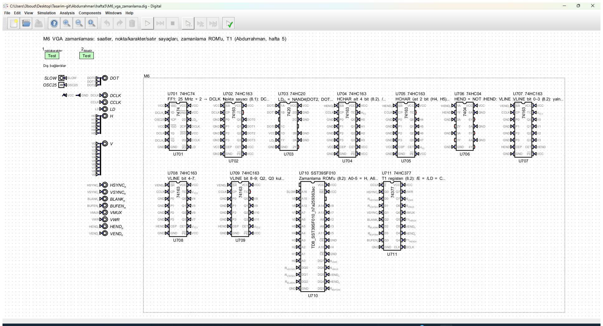
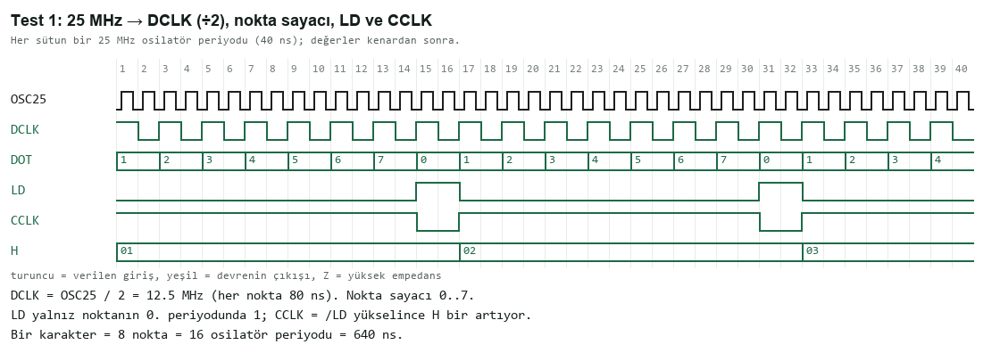
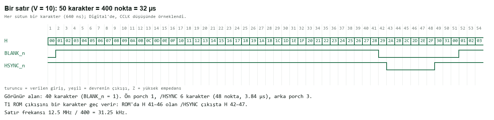
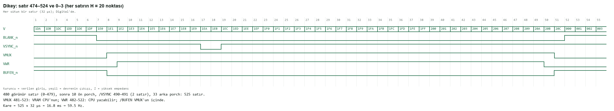
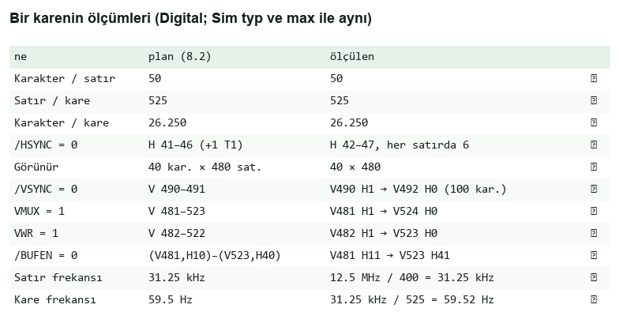

# Hafta 5 (24–30 Kasım 2026): M6 VGA zamanlaması, Digital'de

Hazırlayan: Abdurrahman

> **Not:** M6 projenin netlist'inde (`sim/ta8/hw/cpu.py`) henüz yoktu; bu modülün bağlantıları [SISTEM-PLANI bölüm 8.1–8.2](../../SISTEM-PLANI.md)'den yeni çıkarıldı. Kullanılan araçlar projenin araçları: çip modelleri (`sim/ta8/hw/chips.py`), çip seviyesi simülatör (`sim/ta8/hw/kernel.py`), Digital dışa aktarıcısı (`sim/ta8/hw/digital.py`) ve zamanlama ROM'u üreticisi (`sim/ta8/vga.py`). Her şey `m6_uret.py` ile yeniden üretilebilir.

## Özet

- **M6'nın zamanlama kısmı** kuruldu: 25 MHz → nokta saati, nokta / karakter / satır sayaçları, zamanlama ROM'u ve T1 registerı. **11 entegre** (U701–U711).
- Bir kare planla birebir aynı: **50 × 525 karakter**, satır 31.25 kHz, kare 59.5 Hz, /HSYNC 6 karakter, /VSYNC 2 satır, 40 × 480 görünür alan, VMUX / VWR / /BUFEN pencereleri.
- Üç ayrı yoldan denendi ve **üçü aynı sonucu verdi**: Digital'in test aracı (2 test), Digital'de 2 tam kare, projenin çip seviyesi simülatöründe gerçek 25 MHz saatle (tipik ve en kötü gecikmeler).
- **Açılışta kendini toparlıyor:** rastgele açılış durumlarından en geç **1 kare** içinde doğru kareye kilitleniyor (plan: "bir kare içinde").
- **Bulgu:** en kötü gecikme değerleriyle 74HC74 25 MHz'i ikiye bölemiyor (aşağıda). Prototip c'de denenmeli.
- Karakter hattı (VRAM, font ROM'u, 74HC166, 157'ler) ve çıkış katı bu notta yok; [hafta 5.1](../hafta5.1/README.md)'de yapıldı.

## Dosyalar

| Dosya | İçerik |
|---|---|
| `M6_vga_zamanlama.dig` | Devre + 2 test |
| `TA8_SST39SF010_vga_zamanlama.dig` | Zamanlama ROM'unun alt devresi (içerik gömülü; `.dig` ile aynı klasörde durmalı) |
| `m6_uret.py` | Netlist (`chips()`), Digital dosyası, testler, kare ölçümleri, gecikme analizi |
| `images/m6_digital_ekran.png`, `images/m6_devre.svg` | Devrenin Digital'deki görüntüsü |
| `images/m6_1_nokta_karakter.png`, `m6_2_satir.png`, `m6_3_dikey.png` | Dalga şekilleri |
| `images/m6_4_olcumler.png` | Bir karenin ölçümleri ve planla karşılaştırma |
| `images/sonuclar.json` | Bütün ölçümlerin ham sonuçları |

## Devre

| Entegre | Görev | Bağlantı |
|---|---|---|
| U701 74HC74 | FF1: **÷2** (25 MHz → DCLK 12.5 MHz). FF2: **LD flip-flop'u** | FF1: CP = OSC25, D = /Q. FF2: CP = DCLK, D = LD_D; LD = /Q, CCLK = Q |
| U702 74HC163 | **Nokta sayacı** (0..7) | CP = DCLK, hep sayar; Q0–Q2 = DOT0–2 |
| U703 74HC20 | LD_D = NAND4(DOT2, DOT1, DOT0, 1) | Nokta 7'de 0 → bir DCLK sonra LD = 1 (noktanın 0. periyodu) |
| U704, U705 74HC163 | **HCHAR** (H0–H5, 0..49) | CP = CCLK; /MR (senkron) = /HEND; U704 TC → U705 CET |
| U706 74HC04 | HEND = NOT /HEND | VLINE'ın sayma izni |
| U707–U709 74HC163 | **VLINE** (V0–V9, 0..524) | CP = CCLK; CEP = HEND (satır sonunda bir artar); /MR = /VEND; TC zinciri |
| U710 SST39SF010 | **Zamanlama ROM'u** | A0–5 = H, A6–15 = V, A16 = SLOW. D0–D7 = /HSYNC, /VSYNC, BLANK_n, /BUFEN, /HEND, /VEND, VMUX, VWR (içerik `ta8.vga.timing_rom()`) |
| U711 74HC377 | **T1**: ROM çıkışlarını karakter sınırında yakalar | CP = DCLK, /E = CCLK (= /LD); Q = /HSYNC, /VSYNC, BLANK_n, /BUFEN, VMUX, VWR |

Tasarımda plan bir ayrıntı vermediği için seçilen yerler:
- Sayaçları temizleyen /HEND ve /VEND, T1'den değil **doğrudan ROM'dan** alındı (plan 8.2: "temizleme sinyalleri ROM'dan gelir"). 163'ün /MR'ı senkron olduğu için ROM çıkışındaki adres değişimi geçişleri sorun değil; yalnız CCLK kenarındaki değer sayılır.
- VLINE'ın sayma izni HEND = NOT /HEND (H = 49'da 1): satır sonunda H 0'a dönerken V bir artar; /VEND (V = 524, H = 49) aynı kenarda V'yi de 0 yapar.
- T1'in /E'si CCLK (= /LD): T1 yalnız LD = 1 iken (noktanın 0. periyodu) DCLK kenarında yükler. Bu yüzden çıkışlar ROM'a göre **bir karakter geç** gelir (ROM'da H 41–46 olan /HSYNC çıkışta H 42–47); plan 8.3'teki gibi, glyph de bir karakter sonra kaydırıldığı için hizalı.

## Testler

### Test 1: Nokta ve karakter saatleri (Digital test case `1_nokta_karakter`, geçti)

| Ne verildi | Ne bekleniyordu | Ne görüldü |
|---|---|---|
| 25 MHz osilatör, 40 periyot | DCLK = 12.5 MHz; nokta sayacı 0..7; LD yalnız nokta 0'da; her 8 noktada H + 1 | DCLK her 2 osilatör periyodunda bir; DOT 0..7; LD = 1 yalnız DOT = 0'da; H 16 osilatör periyodunda (640 ns) bir artıyor. **Geçti** |

### Test 2: İki satır (Digital test case `2_iki_satir`, 1.632 adım, geçti)

| Ne verildi | Ne bekleniyordu | Ne görüldü |
|---|---|---|
| 2 satır + 2 karakter boyunca osilatör | H 0..49 ve 0'a dönüş; görünür 40 karakter; /HSYNC 6 karakter; satır sonunda V + 1 | H 0..49 → 0; BLANK_n 40 karakter 1; /HSYNC H 42–47'de 0; H 0'a dönerken V = 1. **Geçti** |

### Test 3: Tam kare (Digital'de 2 kare, 924.000 osilatör periyodu)

Her karakterde (CCLK düşüşü) H, V ve 6 çıkış kaydedildi; açılıştan sonraki ilk tam kare ölçüldü. **Bütün değerler planla aynı.**

### Test 4: Gerçek 25 MHz ve gecikmeler (projenin çip seviyesi simülatörü)

Digital gecikmeleri modellemez. Aynı netlist `sim/ta8/hw/kernel.py`'de, her entegrenin gecikmesi ve kurulum/tutma süreleriyle, **gerçek 25 MHz saatle** 2.2 kare koşturuldu.

| Koşu | Kurulum / tutma ihlali | Kare ölçümleri | Digital ile karakter karakter |
|---|---|---|---|
| Tipik gecikmeler, 25 MHz | **0** (açılıştaki ilk 20 ns hariç) | planla aynı | **aynı** (31.500 karakter) |
| En kötü gecikmeler, DCLK 12.5 MHz doğrudan verildi (÷2 atlandı) | **0** | planla aynı | **aynı** |
| En kötü gecikmeler, 25 MHz osilatör | 0, ama **karakter periyodu 1.280 ns** (640 olmalı) | yanlış hız | |

**Bulgu: ÷2 flip-flop'u en kötü köşede yetişmiyor.** ÷2 bağlantısında (D = /Q) flip-flop'un kendi gecikmesi + kurulum süresi bir osilatör periyodundan kısa olmalı: 40 ns. Simülatörün en kötü değerleriyle 44 ns (CP → Q) + 15 ns (kurulum) = 59 ns, bu yüzden FF her iki kenarda bir değişiyor ve DCLK 6.25 MHz'e düşüyor. Bu değerlerin bir kısmı tahmin (`chips.py`'de "T" işaretli) ve hepsini aynı anda en kötü almak kötümser; 74HC74 datasheet'leri 4.5 V'ta en az ~25–30 MHz toggle frekansı veriyor. Yani tipik çiplerle çalışır, ama pay az. Öneriler:
- Prototip c'de DCLK'yi osiloskopla ölçmek (12.5 MHz mi?), soğuk ve ısınmış halde.
- Pay için ÷2'yi daha hızlı bir aileden yapmak (ör. 74AC74 / 74F74) ya da doğrudan 12.5 MHz'lik bir osilatör kullanmak (o zaman ÷2 FF'si kalkar, LD FF'si kalır).

÷2'den sonraki devre (12.5 MHz) en kötü gecikmelerde de ihlalsiz: en yavaş yol olan ROM (70 ns) → T1 ve sayaçların temizlemesi, karakter periyodunun (640 ns) çok altında.

### Test 5: Açılışta kendini toparlama

Simülatörde bütün flip-flop ve sayaçlar **rastgele** değerlerle açıldı (3 farklı tohum):

| Tohum | İlk (V, H) = (0, 0) | Sonraki kare | İhlal |
|---|---|---|---|
| 1 | 0.39 kare sonra | planla aynı | 0 |
| 2 | 0.48 kare sonra | planla aynı | 0 |
| 3 | 1.00 kare sonra | planla aynı | 0 |

ROM, kullanılmayan H ≥ 50 ve V ≥ 525 adreslerinde de /HEND ve /VEND'i 0 veriyor; sayaçlar hangi değerle açılırsa açılsın bir karede doğru diziye giriyor. (V'nin kullanılmayan V10, V11 bitleri ROM'a gitmiyor; bunlar 1 açılırsa V 1024'ü geçene kadar sayabilirdi. Simülatörün rastgele açılışında bu durum çıkmadı; gerçek devrede bu bitler U709'un Q2, Q3'ü. Gerekirse bir kapıyla /VEND'e eklenebilir.)

## Sınırlar ve sonraki adımlar

- **SLOW modu** (A16 = 1, banka 1) yalnız ROM içeriğinde var; testler SLOW = 0 ile. CPU ile VRAM paylaşımı [hafta 5.1](../hafta5.1/README.md)'de denendi.
- **Karakter hattı** (VRAM adres seçimi 3× 74HC157, VRAM CY62256, font ROM'u, 74HC166, DB → VRAM tamponu 74HC245) ve **çıkış katı** (R, G, B = AND(QH, BLANK_n), dirençler): [hafta 5.1](../hafta5.1/README.md)'de yapıldı.
- **Prototip c** (gerçek monitör): parçalar gelince; ilk ölçüm DCLK frekansı (yukarıdaki bulgu).
- Bu modül henüz projenin netlist'inde (`cpu.py`) değil; Taha'yla konuşup oraya eklenebilir (şu an `TB` taklitleri VGA'nın yerini tutuyor).
