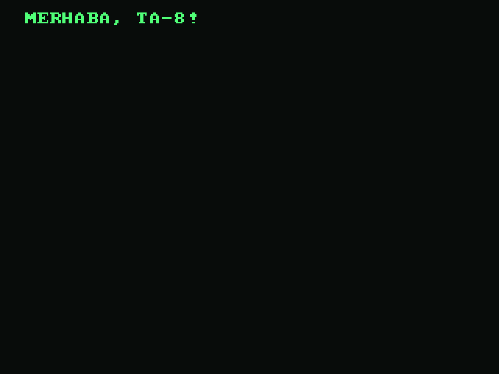
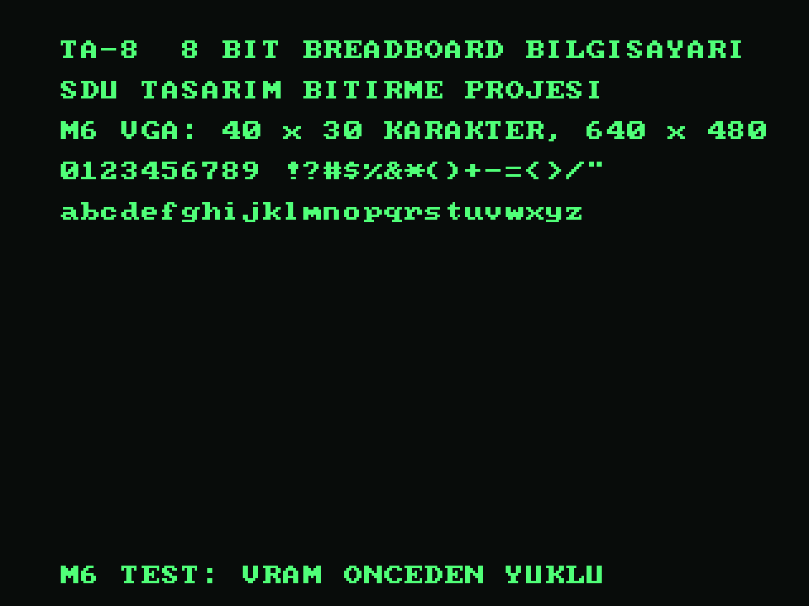

# Hafta 6 (1–7 Aralık 2026): M6 netlist'te, KiCad şemaları, malzeme listesi

Hazırlayan: Abdurrahman

## Özet

- **M6'nın tamamı ana netlist'te (19/19 entegre):** `sim/ta8/hw/cpu.py` `m6_vga()`. Zamanlama (U701–U711, `hafta5/m6_uret.py`'den taşındı) + karakter hattı (U712–U719): 3× 74HC157, VRAM, DB tamponu, font ROM'u, 74HC166, çıkış katı. VRAM taklidi X1 kalktı.
- **Devrenin görüntüsü nokta nokta doğru:** VIDEO çıkışı her DCLK'de yakalanıyor; 480 × 320 noktanın hepsi VRAM + font ROM'undan hesaplanan görüntüyle aynı (`sim/ta8/hw/screen.py`).
- **Gerçek font:** `font8x8_basic` (kamu malı) `sim/fonts/`'ta; `vga.default_font()`, `py cli.py roms` ve M6 artık bunu kullanıyor (test deseni: `--test-font`).
- **Bulgu:** pencerede /BUFEN kapalıyken VD0–7 yüzüyordu (font ROM'unun girişleri boşta). 10k pull-down SIP dizisi eklendi (planda yok).
- **CPU + M6 birlikte çalışıyor:** `merhaba.asm`, gerçek 25 MHz VGA zamanlamasıyla, emülatörle **sıfır fark**. CPU, M6'nın açtığı VRAM penceresini ~15,4 ms bekliyor; "MERHABA, TA-8!" VRAM'e 482–522. satırlar arasında yazılıyor, pencere dışında yazma yok.
- **VWR senkronlayıcısı kuruldu:** M1'deki U111'in boş iki flip-flop'u VWR'yi (T1 Q7) iki MCLK ile VWR_s'e çeviriyor (plan 3.6).
- **KiCad şemaları** netlist'ten üretiliyor: `py cli.py hw kicad` → `sim/kicad/`, PDF: [TA8_semalar.pdf](TA8_semalar.pdf).
- **Malzeme listesi:** [BOM.md](BOM.md), LCSC'ye yüklenecek dosya [BOM-lcsc.csv](BOM-lcsc.csv).

## 1. İki kip: `build(vga=...)`

| Kip | M6 | VWR_s | VRAM | Hız | Kullanım |
|---|---|---|---|---|---|
| `'taklit'` (varsayılan) | yok | test tezgâhından | X1 taklidi | hızlı | sıfır fark testleri, Digital dosyaları |
| `'netlist'` | U701–U719, OSC25 = 25 MHz | U111 FF2/FF3, VWR'den | U715 | ~25 kat yavaş | M6 testleri, KiCad, bağlantı tablosu |

```
HwCpu(prog.image, vga='netlist')      # test tezgâhı
cpu.build(vga='netlist')               # yalnız netlist
```

Pencere kapalıyken WAIT bir kareye (16,8 ms) kadar sürebildiği için `HwCpu.run()`'ın "takıldı" sınırı netlist kipinde 5 ms'den 20 ms'ye çıktı.

## 2. Sonuçlar

| Test | Sonuç |
|---|---|
| merhaba.asm, CPU + M6, emülatörle karşılaştırma | sıfır fark, 573 çevrim, HALT |
| VRAM yazmaları | 14, hepsi satır 482–522 arasında; pencere dışında 0 |
| WAIT ile bekleme | 15,4 ms (açılışta kare 0, pencere satır 482'de açılıyor) |
| M6 ile CPU'nun ortak netleri | yalnız VWR ve SLOW (istenmeyen çakışma yok) |
| Yalnız M6, VRAM'de 3 satır yazı + çerçeve, 2 kare | 480 × 320 noktanın hepsi beklenen görüntüyle aynı |
| CPU + M6, merhaba.asm | yazmalardan sonraki kare beklenen görüntüyle aynı, ilk kare boş |
| Entegre sayımı (M6) | plan 19, netlist 19, açıklanmamış fark 0 |



*CPU + M6: `merhaba.asm` "MERHABA, TA-8!" yazısını VRAM'e yazıyor, M6 sonraki karede çiziyor. Görüntü devrenin VIDEO çıkışından nokta nokta alındı (gerçek font: `font8x8_basic`, kamu malı, `sim/fonts/`).*



*Yalnız M6: VRAM'e önceden yazı yüklendi (CPU yok); büyük/küçük harf, rakam ve işaretler.*

### Zamanlama ihlalleri

| İhlal | Ne zaman | Sonuç |
|---|---|---|
| VD0–7 yüzüyor (font ROM'u) | pencerede /BUFEN kapalıyken | **Düzeltildi:** 10k pull-down |
| U715/U716 çakışma ~650 ns | açılış, T1 ilk değerini yüklemeden | Gerçekte de olabilir (377 rastgele açılır), < 1 µs, zararsız |
| U718 (166) setup | yalnız VMUX penceresinde (satır ≥ 480) | VD orada DB'yi izliyor; çıkış BLANK_n = 0 ile kapalı, ekranda etkisi yok (test ediliyor) |
| U404/U601 vb. çakışmalar | CPU, M6'sız da aynı sayıda | Eski, bilinen devir-teslim (~11 ns) |

Testler: `sim/tests/test_m6_netlist.py` (12 test), `test_kicad.py` M6 dahil kartla.

## 3. Sırada

- **Digital'de ekranda yazı (K3):** `py cli.py hw digital` M6'yı da dışa aktarmalı; Digital'in VGA bileşeniyle.
- **M7 PS/2.**
